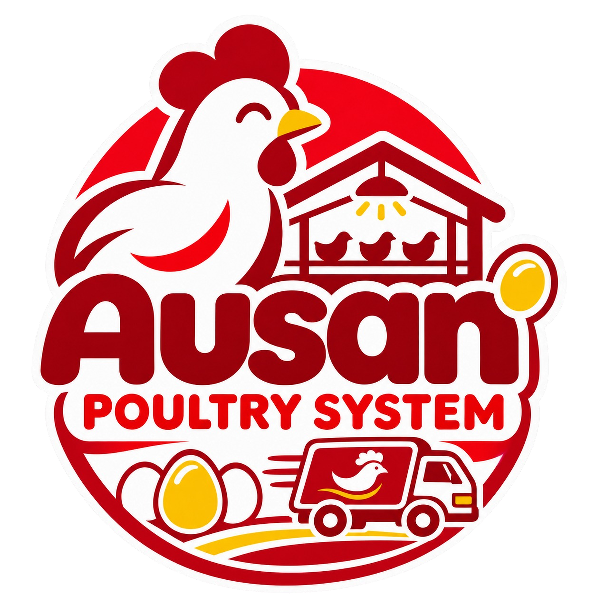

<p align="center">
  
</p>

<h1 align="center">Ausan Poultry System</h1>

<!-- Badges: CI, CD, Java, Spring Boot, React, TypeScript, PostgreSQL, Docker -->
<p align="center">
  <a href="https://github.com/kyledelfin2006/ausan-poultry-system/actions/workflows/ci.yml"></a>
  
  
  
  
  
  
</p>

> **Naming.** The official name of the system is **Ausan Poultry System**; the repository is `ausan-poultry-system`. The Maven artifact (`poultry`) and Java package (`kyle.poultry`) are technical identifiers and keep their names.

## Project Overview

The **Ausan Poultry System** is the backend for the Ausan Poultry Farm business. Despite the name, Ausan is a **trading business**, not a farm: it buys cages, chickens, nipples, feeders, feed bags and water jugs from suppliers and resells them in pre-set **packages** through **deliveries**, across two branches. Currency is PHP.

Before the system, stock, deliveries and money lived in paper logs, notepads and phone calls. The system replaces them with one shared record: a paid delivery creates the stock movement, the sale, the cost of goods and the payment in a single transaction, and nothing saved is ever edited or deleted, so the owner can audit the history.

| Layer | Technology |
|---|---|
| Language / runtime | Java 25 |
| Framework | Spring Boot 4.1 (Web MVC, Data JPA, Security, Validation, Actuator) |
| Database | PostgreSQL 17, Flyway migrations |
| Auth | Stateless JWT (HS256), username and password |
| API contract | OpenAPI (springdoc), committed as `docs/api/openapi.json` |
| Tests | JUnit 5, Testcontainers (real PostgreSQL), ArchUnit, JaCoCo, Spring REST Docs |
| Packaging | Docker (multi-stage, layered jar), Docker Compose |
| CI | GitHub Actions, Dependabot |
| Frontend | React + Vite + TypeScript, **not started** |

## Table of Contents

- [Project Overview](#project-overview)
- [Features](#features)
- [Architecture](#architecture)
- [Notable code changes](#notable-code-changes)
- [Engineering problems solved](#engineering-problems-solved)
- [Demo Accounts](#demo-accounts)
- [Quick Start](#quick-start)
  - [Prerequisites](#prerequisites)
  - [Installation](#installation)
- [Configuration & Secrets Management](#configuration--secrets-management)
  - [Environment Variables](#environment-variables)
  - [CI/CD Secrets](#cicd-secrets)
  - [Security Policy](#security-policy)
- [API Usage & Documentation](#api-usage--documentation)
  - [Authentication](#authentication)
  - [Request/Response Examples](#requestresponse-examples)
  - [API Reference](#api-reference)
- [Docker Infrastructure](#docker-infrastructure)
  - [Container topology](#container-topology)
  - [File inventory](#file-inventory)
  - [The application image (Dockerfile)](#the-application-image-dockerfile)
  - [Local stack (docker-compose.yml)](#local-stack-docker-composeyml)
  - [Production override (infra/docker-compose.prod.yml)](#production-override-infradocker-composeprodyml)
  - [Caddy reverse proxy](#caddy-reverse-proxy)
  - [Operations scripts](#operations-scripts)
  - [Networking, ports, volumes, and health](#networking-ports-volumes-and-health)
  - [Image pinning and updates](#image-pinning-and-updates)
  - [Docker safety rules](#docker-safety-rules)
- [CI/CD Pipeline Architecture](#cicd-pipeline-architecture)
  - [Pipeline Flow](#pipeline-flow)
  - [Workflow Breakdown](#workflow-breakdown)
  - [Triggers & Quality Gates](#triggers--quality-gates)
- [Deployment](#deployment)
  - [Environments](#environments)
  - [Deployment Process](#deployment-process)
  - [Manual Deployment & Rollback](#manual-deployment--rollback)
- [Testing](#testing)
- [Documentation](#documentation)
  - [Repo map](#repo-map)
- [Contributing](#contributing)
- [Project Status](#project-status)
- [License](#license)

---

## Features

- **Catalog:** products, branches and sales packages (Small 70,000; Medium 160,000; Commercial 700,000 PHP), each package a fixed set of products. Package prices and contents are still being finalised by the owner.
- **Stock ledger:** append-only stock movements (purchase, opening stock, donation, usage, adjustment, delivery) with per-branch balances, an all-branch summary and reorder-level flags.
- **Weighted average costing:** every branch and product keeps an average cost updated on purchases; opening stock and donations cost 0.
- **Finance ledger:** append-only entries for expenses, sales, cost of goods and payments.
- **Deliveries:** create (paid in full), mark done, cancel, refund; frozen package names and prices; idempotent creation with `Idempotency-Key`; filters, status counts and an owner's receipt.
- **Reports:** period summary, profit, inventory value, dashboard figures, day/month series and CSV exports.
- **Identity and security:** two roles (OWNER, ASSISTANT), user administration, password rules, login throttling, logout with immediate session revocation, CORS and security headers.
- **Audit and observability:** audit trail of master-data changes, request ids, structured logs and Prometheus metrics.

Who can do what:

| Action | OWNER | ASSISTANT |
|---|---|---|
| Record purchases, donations, usage, expenses | yes | yes |
| Create deliveries, mark them done | yes | yes |
| Opening stock and adjustments | yes | no |
| Cancel deliveries, record refunds | yes | no |
| Edit products, branches, packages; create users | yes | no |
| Profit reports, delivery receipts (cost and profit), reorder levels, audit trail | yes | no |

Key business rules:

- **Append-only ledgers.** Stock movements and financial entries are never updated or deleted. A correction is a reversal or an opposite entry.
- **Payment.** A delivery is paid in full when created: it records the sale, the cost of goods and the payment.
- **Cancellation.** Owner only, only while ACTIVE. Stock returns at its original cost; sale and cost are reversed, but the payment stays on record as money held until refunded.
- **Refunds.** Owner only, only for cancelled deliveries, never more than the payment still held; partial refunds are allowed.
- **Done deliveries cannot be cancelled.** DONE and CANCELLED are final.
- No transfers between branches.

## Architecture

A **modular monolith** in `kyle.poultry` with PostgreSQL as the only dependency ([ADR-0001](docs/architecture/decisions/0001-modular-monolith.md)).

| Module | Responsibility |
|---|---|
| `identity` | users, roles, login, JWT, owner bootstrap |
| `catalog` | products, branches, sales packages |
| `stock` | append-only stock movements, balances, weighted average cost |
| `finance` | append-only financial ledger |
| `delivery` | deliveries and their lifecycle; orchestrates stock and finance |
| `report` | read-only period reports, dashboard and series |
| `audit` | append-only audit trail of master-data changes |
| `shared` | error handling and stable error codes, paging format, OpenAPI contract, exceptions, clock |

**Rule: modules talk to each other only through their public `*Api` interfaces** (`CatalogApi`, `StockApi`, `FinanceApi`). Implementations, entities and repositories are package-private. ArchUnit tests fail the build if this is broken.

Full detail: [architecture overview](docs/architecture/overview.md), [data model](docs/architecture/data-model.md), [ledger and costing](docs/architecture/ledger-and-costing.md), [sequences](docs/architecture/sequences.md), [glossary](docs/architecture/glossary.md).

## Notable code changes

Design decisions are recorded as ADRs in [docs/architecture/decisions/](docs/architecture/decisions/README.md):

| ADR | Decision |
|---|---|
| [0001](docs/architecture/decisions/0001-modular-monolith.md) | Modular monolith instead of microservices |
| [0002](docs/architecture/decisions/0002-append-only-ledgers.md) | Append-only stock and finance ledgers |
| [0003](docs/architecture/decisions/0003-stateless-jwt-with-database-recheck.md) | Stateless JWT, re-checked against the database on every request |
| [0004](docs/architecture/decisions/0004-weighted-average-in-sql.md) | Weighted average cost computed in one SQL statement |
| [0005](docs/architecture/decisions/0005-idempotent-delivery-creation.md) | Idempotent delivery creation |
| [0006](docs/architecture/decisions/0006-real-postgresql-in-tests.md) | Real PostgreSQL in tests, pure units for logic |

The project history (feature slices, quality gates, API contract finalisation) is in the [pull requests](https://github.com/kyledelfin2006/ausan-poultry-system/pulls?q=is%3Apr).

## Engineering problems solved

- **Overlapping requests.** Two staff, a retrying phone, or a cancel racing a "done" must not corrupt stock or money. The code uses no Java locks: every guarantee is a row lock, advisory lock, atomic statement or constraint, each proven by a concurrency test against real PostgreSQL ([consistency and concurrency](docs/architecture/consistency-and-concurrency.md)).
- **Safe retries.** A dropped connection leaves the client unsure whether a delivery was created. `Idempotency-Key` makes the retry return the original delivery; two simultaneous requests with one key create exactly one delivery.
- **Correct cost of goods.** The weighted average is updated atomically in SQL, so concurrent purchases cannot read a stale average.
- **All-or-nothing sales.** Stock for every package line, the sale, cost and payment are written in one transaction; insufficient stock saves nothing.
- **Immediate session revocation.** Tokens are stateless, but the user is re-checked on every request, so deactivating a user or logging out ends their sessions at once.
- **A contract the frontend can trust.** The OpenAPI spec is generated from the code and compared with the committed copy by a snapshot test, and error codes are stable and tested.

## Demo Accounts

There are **no seeded demo accounts** and no demo data. The first OWNER is created from environment variables when the user table is empty (see [Configuration](#configuration--secrets-management)); that owner creates ASSISTANT accounts through `POST /api/users`. For local development, use the throw-away values shown in [Installation](#installation).

## Quick Start

### Prerequisites

- JDK 25
- Docker Desktop running (PostgreSQL for development and for the tests)
- Nothing else: the Maven wrapper (`mvnw`) is included

### Installation

The dev `compose.yaml` starts PostgreSQL automatically when the app starts (Spring Boot docker-compose support).

PowerShell:

```powershell
git clone https://github.com/kyledelfin2006/ausan-poultry-system.git
cd ausan-poultry-system

# Signing key: any string of at least 32 bytes
$env:APP_SECURITY_JWT_SECRET = "dev-only-secret-change-me-at-least-32-bytes-long"
# Creates the first OWNER if the user table is empty
$env:APP_BOOTSTRAP_OWNER_USERNAME = "owner"
$env:APP_BOOTSTRAP_OWNER_PASSWORD = "dev-owner-password"

./mvnw spring-boot:run
```

bash: `export` the same three variables, then `./mvnw spring-boot:run`.

The API is then on <http://localhost:8080>. Log in and call it as shown in the [integration guide](docs/api/integration-guide.md).

## Configuration & Secrets Management

### Environment Variables

All production settings come from a `.env` file (template: [.env.example](.env.example); `.env` is git-ignored). Compose refuses to start if a required value is missing.

| Variable | Required | Purpose |
|---|---|---|
| `POSTGRES_DB`, `POSTGRES_USER`, `POSTGRES_PASSWORD` | yes | PostgreSQL container |
| `SPRING_DATASOURCE_URL`, `_USERNAME`, `_PASSWORD` | yes | Datasource used by the app (password must equal `POSTGRES_PASSWORD`) |
| `APP_SECURITY_JWT_SECRET` | yes | HS256 signing key, at least 32 bytes. Changing it logs everyone out |
| `APP_BOOTSTRAP_OWNER_USERNAME`, `_PASSWORD` | first start only | Creates the first OWNER when no users exist; remove afterwards |
| `APP_CORS_ALLOWED_ORIGINS` | no | Exact frontend origins, comma-separated; empty means same-origin only |
| `SERVER_FORWARD_HEADERS_STRATEGY` | no | Set to `framework` only behind a trusted TLS proxy |
| `APP_PORT` | no | Host port for the API (default 8080) |
| `JAVA_OPTS` | no | JVM flags (default `-XX:MaxRAMPercentage=75`) |

### CI/CD Secrets

The CI workflow needs **no secrets**: it only reads the repository (`permissions: contents: read`) and runs tests against a Testcontainers PostgreSQL. There is no CD workflow yet, so no deployment credentials exist in GitHub.

### Security Policy

There is no separate `SECURITY.md`. The security reference (assets, threat model, controls and the test behind each) is in [docs/security/](docs/security/README.md). To report a vulnerability, contact the repository owner privately rather than opening a public issue.

## API Usage & Documentation

### Authentication

Exchange a username and password for a JWT (valid 8 hours, no refresh) and send it as `Authorization: Bearer <token>`. After 5 failed attempts in 15 minutes a username is throttled (`429`). See [auth](docs/api/auth.md) and [auth-session](docs/api/auth-session.md).

```http
POST /api/auth/login
Content-Type: application/json

{ "username": "owner", "password": "your-password" }
```

```json
{ "token": "eyJhbGciOiJIUzI1NiJ9...", "expiresAt": "2026-11-20T10:15:00Z", "role": "OWNER", "displayName": "Owner" }
```

### Request/Response Examples

Create a delivery (safe to retry with the same `Idempotency-Key`):

```http
POST /api/deliveries
Authorization: Bearer <token>
Idempotency-Key: 6f1c1d3e-5b0a-4a52-9d2b-0c3a6a1c9a10
Content-Type: application/json

{ "customerName": "Juan dela Cruz", "driverName": "Pedro Reyes", "fromBranchId": 1,
  "destination": "Brgy. San Isidro, Tarlac", "paymentMethod": "GCASH",
  "lines": [ { "packageId": 1, "quantity": 1 } ] }
```

`201`:

```json
{ "id": 7, "code": "DLV-2026-0007", "status": "ACTIVE", "customerName": "Juan dela Cruz", "driverName": "Pedro Reyes",
  "fromBranchId": 1, "destination": "Brgy. San Isidro, Tarlac", "total": 70000.00, "paymentMethod": "GCASH",
  "lines": [ { "packageId": 1, "packageName": "Package Small", "quantity": 1, "unitPrice": 70000.00, "lineTotal": 70000.00 } ] }
```

Errors are RFC 9457 problem objects with a stable `code`, for example `409` when stock is insufficient (nothing is saved). All codes: [errors.md](docs/api/errors.md).

### API Reference

| Resource | Page |
|---|---|
| Conventions, paging | [docs/api/README.md](docs/api/README.md) |
| Building a client (start here) | [integration-guide.md](docs/api/integration-guide.md) |
| Errors | [errors.md](docs/api/errors.md) |
| Auth, users, audit | [auth.md](docs/api/auth.md), [auth-session.md](docs/api/auth-session.md), [users.md](docs/api/users.md), [audit.md](docs/api/audit.md) |
| Catalog | [catalog.md](docs/api/catalog.md) |
| Stock | [stock.md](docs/api/stock.md), [stock-overview.md](docs/api/stock-overview.md) |
| Finance | [finance.md](docs/api/finance.md) |
| Deliveries | [deliveries.md](docs/api/deliveries.md), [deliveries-queries.md](docs/api/deliveries-queries.md) |
| Reports | [reports.md](docs/api/reports.md), [reports-dashboard-series.md](docs/api/reports-dashboard-series.md), [exports-csv.md](docs/api/exports-csv.md) |
| Machine-readable spec | [openapi.json](docs/api/openapi.json); the running app serves it at `/v3/api-docs` (bearer token required) |

**Keeping the contract in sync.** `OpenApiSnapshotTests` fails when the code and `docs/api/openapi.json` differ. After an intended API change run `./mvnw test "-Dtest=OpenApiSnapshotTests" "-Dopenapi.update=true"`, commit the regenerated file and update the matching page under `docs/api/`.

## Docker Infrastructure

### Container topology

```
            host :${APP_PORT:-8080}
                    |
              +-----v------+  JDBC   +-------------+
              |    app     +--------->  postgres   |   (no published port in production)
              | Spring Boot|         | PostgreSQL 17|
              +------------+         +------+------+
                                            |
                                     volume pgdata
```

Production runs two containers, `app` and `postgres`, on one private Compose network. There is no reverse proxy in this repository yet.

### File inventory

| File | Purpose |
|---|---|
| `Dockerfile` | Multi-stage build of the application image |
| `compose.yaml` | Development: PostgreSQL only (the app runs from your IDE or `mvnw`) |
| `compose.prod.yaml` | Production: app + PostgreSQL, settings from `.env` |
| `.env.example` | Template for production settings |
| `.dockerignore` | Keeps the build context small |
| `scripts/backup.{sh,ps1}`, `scripts/restore.{sh,ps1}` | Backup and restore |

### The application image (Dockerfile)

- **Build stage** (`eclipse-temurin:25-jdk`): copies `mvnw` and `pom.xml` first so the dependency layer is cached, builds the jar with tests skipped (CI runs them), and extracts a **layered jar**.
- **Runtime stage** (`eclipse-temurin:25-jre-alpine`): runs as a non-root `app` user, copies layers from least to most frequently changed, sets `SPRING_PROFILES_ACTIVE=prod`.
- `HEALTHCHECK` calls `/actuator/health`; `exec java` makes the JVM PID 1 so it receives SIGTERM and shuts down gracefully.

### Local stack (docker-compose.yml)

`compose.yaml` runs only `postgres:17` (database, user and password `poultry`, port `5432`, volume `pgdata`). Spring Boot's docker-compose support starts it with the app. Do not reuse these credentials anywhere real.

### Production override (infra/docker-compose.prod.yml)

This repository has no `infra/` folder and no override file: production is the single, self-contained [compose.prod.yaml](compose.prod.yaml). It requires every secret from `.env`, restarts containers `unless-stopped`, starts the app only after PostgreSQL is healthy, and allows 40 s for graceful shutdown.

```powershell
Copy-Item .env.example .env      # then edit every placeholder
docker compose -f compose.prod.yaml --env-file .env up -d --build
```

### Caddy reverse proxy

Not used. TLS termination is not part of this repository. If you put a TLS proxy in front, set `SERVER_FORWARD_HEADERS_STRATEGY=framework` so HSTS and redirects see HTTPS, and list the frontend origin in `APP_CORS_ALLOWED_ORIGINS` (or serve frontend and `/api` from one origin). See [docs/security/README.md](docs/security/README.md).

### Operations scripts

| Script | Does |
|---|---|
| `scripts/backup.sh` / `backup.ps1` | `pg_dump` (custom format) to `ausan-YYYYMMDD-HHMMSS.dump`, writes to a `.partial` file first, prunes to the newest `BACKUP_KEEP` (default 14) |
| `scripts/restore.sh` / `restore.ps1` | Restores a dump into the compose database |

Scheduling examples (cron, Windows Task Scheduler) and a restore drill are in [docs/operations.md](docs/operations.md).

### Networking, ports, volumes, and health

- **Ports:** the app is published on `${APP_PORT:-8080}`; PostgreSQL is **not** published in production (only the app can reach it). Development publishes `5432`.
- **Volumes:** `pgdata` (named `ausan_pgdata` in production) holds the database and survives rebuilds.
- **Health:** PostgreSQL uses `pg_isready`; the app uses `/actuator/health`. In production only `/actuator/health` and `info` are exposed.

### Image pinning and updates

Base images are pinned to a major tag (`postgres:17`, `eclipse-temurin:25-*`), not a digest. Dependabot opens weekly update pull requests for Maven, GitHub Actions and Docker, and each runs the full CI.

### Docker safety rules

- Never commit `.env`; keep production passwords long and random.
- Do not publish the PostgreSQL port in production.
- Do not run `docker compose down -v` (or delete `ausan_pgdata`) unless you mean to destroy the data; take a backup first.
- Set `SERVER_FORWARD_HEADERS_STRATEGY=framework` only behind a proxy you control; otherwise clients can forge `X-Forwarded-*`.
- Remove the `APP_BOOTSTRAP_OWNER_*` values after the first start.

## CI/CD Pipeline Architecture

### Pipeline Flow

```
pull request / push to main
        |
        +--> verify  : ./mvnw verify  -> tests + architecture rules + coverage gate -> coverage summary + artifacts
        |
        +--> javadoc : ./mvnw javadoc:javadoc  (parallel, no Docker)
```

Continuous **integration** only. There is no automated delivery or deployment stage.

### Workflow Breakdown

[.github/workflows/ci.yml](.github/workflows/ci.yml):

| Job | What it does |
|---|---|
| `verify` | Java 25 (Temurin) with Maven cache, `./mvnw -B -ntp verify` (unit, integration against PostgreSQL via Testcontainers, concurrency and ArchUnit tests, JaCoCo check), prints a per-package coverage table on the run page, uploads the `jacoco-report` artifact and, on failure, the Surefire reports |
| `javadoc` | Javadoc lint in parallel: malformed tags, broken links or bad HTML fail the build |

### Triggers & Quality Gates

Triggers: every pull request and every push to `main`. A newer push to the same pull request cancels the older run; runs on `main` are never cancelled.

| Gate | Fails the build when |
|---|---|
| Tests | any test fails |
| Coverage floor (JaCoCo) | line coverage < 85 % or branch coverage < 75 % |
| Architecture rules (ArchUnit) | a module boundary or coding rule is broken |
| Javadoc lint | a malformed tag, broken `{@link}` or bad HTML |
| Build environment (enforcer) | Java below 25, Maven below 3.9, duplicate dependency versions |
| Migrations | Flyway and Hibernate `validate` disagree |

Details: [docs/quality/](docs/quality/README.md).

## Deployment

### Environments

| Environment | How it runs |
|---|---|
| Development | `./mvnw spring-boot:run` with `compose.yaml` PostgreSQL |
| Production | `compose.prod.yaml` on a host you control, settings from `.env` |

No hosted staging environment is defined in this repository.

### Deployment Process

Deployment is manual: clone the repository on the host, create `.env` from `.env.example`, and run `docker compose -f compose.prod.yaml --env-file .env up -d --build`. Flyway applies pending migrations when the new app starts. Full steps: [docs/operations.md](docs/operations.md).

### Manual Deployment & Rollback

Upgrade by pulling the new revision and re-running the `up -d --build` command. Take a backup first (`./scripts/backup.ps1` or `./scripts/backup.sh`). Rolling back code is a checkout of the previous revision and a rebuild; because applied Flyway migrations are never edited and schema changes are forward-only, rolling back across a migration means restoring the pre-upgrade backup. Procedure, restore drill and troubleshooting: [docs/operations.md](docs/operations.md).

## Testing

```powershell
./mvnw verify                                  # everything: tests, coverage check, report (Docker must be running)
./mvnw javadoc:javadoc                         # Javadoc lint
./mvnw -Dtest=DeliveryServiceUnitTests test    # one class (pure unit tests need no Docker)
```

The suite has about 270 tests: pure unit tests for logic, integration tests against a real PostgreSQL 17 (Testcontainers), concurrency tests, security-matrix tests, ArchUnit architecture rules and the OpenAPI snapshot. The coverage report is written to `target/site/jacoco/index.html`. Guide: [docs/quality/testing-guide.md](docs/quality/testing-guide.md).

## Documentation

### Repo map

```
assets/                 logo
docs/api/               API contract for the frontend, OpenAPI spec
docs/architecture/      overview, data model, ledger and costing, ADRs, glossary
docs/security/          threat model, controls, observability
docs/quality/           quality gates, testing guide, findings
docs/operations.md      deploy, backup, restore
docs/reports.md         report definitions
docs/business-and-system-proposal.md   business problem and scope
docs/design-foundation-and-stock.md    design notes
scripts/                backup and restore
src/main/java/kyle/poultry/   application modules
src/test/java/kyle/poultry/   tests
```

## Contributing

1. Branch from `main` and open a pull request; CI must pass.
2. Run `./mvnw verify` locally (Docker running) before pushing.
3. Follow the [pull request template](.github/pull_request_template.md): tests for new behaviour, API changes reflected in `docs/api/` and the OpenAPI snapshot, decisions recorded as ADRs, modules talking only through `*Api` interfaces.
4. Never edit an applied Flyway migration (V1-V5 and any applied later): changing one breaks every existing database. Add a new migration.

Code documentation standard:

- Every class, interface, record and enum has Javadoc; every method and constructor does too (tests included), with `@param`, `@return` and `@throws` for non-trivial ones.
- Method bodies carry short `//` comments explaining **why**, and comments are updated in the same change as the code.

## Project Status

| Area | State |
|---|---|
| Foundation, identity (JWT), catalog | built, tested |
| Stock ledger and weighted average cost | built, tested |
| Finance ledger | built, tested |
| Packages and deliveries (create, done, cancel, refund, idempotency) | built, tested |
| Reports, dashboard, series, CSV exports | built, tested |
| User administration, login throttling, logout, audit trail, metrics | built, tested |
| Quality gates, production packaging, backups, CI | built |
| API contract (OpenAPI, stable error codes, frontend docs) | built |
| Frontend (React + Vite + TypeScript) | **not started** |
| Automated deployment (CD) | not started |

## License

No license file is included in this repository, so all rights are reserved by the author. Contact the repository owner for permission to use or redistribute the code.
