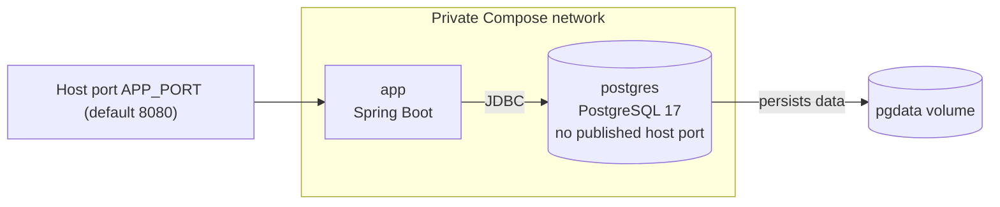
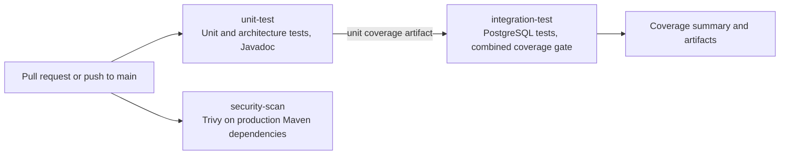

<h1 align="center">Ausan Poultry System - Stock, Delivery and Finance Management</h1>

<p align="center">
  
</p>

<!-- Badges: CI, CD, Java, Spring Boot, React, TypeScript, PostgreSQL, Docker -->
<p align="center">
  <a href="https://github.com/kyledelfin2006/ausan-poultry-system/actions/workflows/ci.yml"></a>
  
  
  
  
  
  
  
</p>

> **Naming.** The official name of the system is **Ausan Poultry System**; the repository is `ausan-poultry-system`. The Maven artifact (`poultry`) and Java package (`kyle.poultry`) are technical identifiers and keep their names.

## Project Overview

The **Ausan Poultry System** is the backend for the Ausan Poultry Farm business. Despite the name, Ausan is a **trading business**, not a farm: it buys cages, chickens, nipples, feeders, feed bags and water jugs from suppliers and resells them in pre-set **packages** through **deliveries**, across two branches. Currency is PHP.

Before the system, stock, deliveries and money lived in paper logs, notepads and phone calls. The system replaces them with one shared record: a paid delivery creates the stock movement, the sale, the cost of goods and the payment in a single transaction, and nothing saved is ever edited or deleted, so the owner can audit the history.

| Layer | Technology |
|---|---|
| Language / runtime | Java 25 |
| Framework | Spring Boot 4.1 (Web MVC, Data JPA, Security, Validation, Actuator) |
| Database | PostgreSQL 17, Flyway migrations |
| Auth | Stateless JWT (HS256), username and password |
| API contract | OpenAPI (springdoc), committed as `docs/api/openapi.json` |
| Tests | JUnit 5, Testcontainers (real PostgreSQL), ArchUnit, JaCoCo, Spring REST Docs |
| Packaging | Docker (multi-stage, layered jar), Docker Compose |
| CI | GitHub Actions, Dependabot |
| Frontend | React + Vite + TypeScript, **not started** |

## Table of Contents

- [Project Overview](#project-overview)
- [Features](#features)
- [Architecture](#architecture)
- [Engineering problems solved](#engineering-problems-solved)
- [Demo Accounts](#demo-accounts)
- [Quick Start](#quick-start)
- [Configuration & Secrets Management](#configuration--secrets-management)
  - [Environment Variables](#environment-variables)
  - [CI/CD Secrets](#cicd-secrets)
  - [Security Policy](#security-policy)
- [API Usage & Documentation](#api-usage--documentation)
- [Docker Infrastructure](#docker-infrastructure)
  - [Container topology](#container-topology)
  - [File inventory](#file-inventory)
  - [The application image (Dockerfile)](#the-application-image-dockerfile)
  - [Local stack (compose.yaml)](#local-stack-composeyaml)
  - [Production stack (compose.prod.yaml)](#production-stack-composeprodyaml)
  - [Operations scripts](#operations-scripts)
  - [Networking, ports, volumes, and health](#networking-ports-volumes-and-health)
  - [Image pinning and updates](#image-pinning-and-updates)
  - [Docker safety rules](#docker-safety-rules)
- [CI/CD Pipeline Architecture](#cicd-pipeline-architecture)
- [Deployment](#deployment)
- [Testing](#testing)
- [Documentation](#documentation)
- [Contributing](#contributing)
- [Project Status](#project-status)
- [License](#license)

---

## Features

- **Catalog:** products, branches and sales packages (Small 70,000; Medium 160,000; Commercial 700,000 PHP), each package a fixed set of products. Package prices and contents are still being finalised by the owner.
- **Stock ledger:** append-only stock movements (purchase, opening stock, donation, usage, adjustment, delivery) with per-branch balances, an all-branch summary and reorder-level flags.
- **Weighted average costing:** every branch and product keeps an average cost updated on purchases; opening stock and donations cost 0.
- **Finance ledger:** append-only entries for expenses, sales, cost of goods and payments.
- **Deliveries:** create (paid in full), mark done, cancel, refund; frozen package names and prices; idempotent creation with `Idempotency-Key`; filters, status counts and an owner's receipt.
- **Reports:** period summary, profit, inventory value, dashboard figures, day/month series and CSV exports.
- **Identity and security:** two roles (OWNER, ASSISTANT), user administration, password rules, login throttling, logout with immediate session revocation, CORS and security headers.
- **Audit and observability:** audit trail of master-data changes, request ids, structured logs and Prometheus metrics.

Roles, the user flow and the business rules (append-only ledgers, cancel and refund policy) are in [docs/product.md](docs/product.md).

## Architecture

A **modular monolith** in `kyle.poultry` with PostgreSQL as the only dependency ([design decision 1](docs/architecture/decisions.md#1-modular-monolith)).

| Module | Responsibility |
|---|---|
| `identity` | users, roles, login, JWT, owner bootstrap |
| `catalog` | products, branches, sales packages |
| `stock` | append-only stock movements, balances, weighted average cost |
| `finance` | append-only financial ledger |
| `delivery` | deliveries and their lifecycle; orchestrates stock and finance |
| `report` | read-only period reports, dashboard and series |
| `audit` | append-only audit trail of master-data changes |
| `shared` | error handling and stable error codes, paging format, OpenAPI contract, exceptions, clock |

**Rule: modules talk to each other only through their public `*Api` interfaces** (`CatalogApi`, `StockApi`, `FinanceApi`). Implementations, entities and repositories are package-private. ArchUnit tests fail the build if this is broken.

Full detail: [architecture overview](docs/architecture/overview.md), [data model](docs/architecture/data-model.md), [ledgers and concurrency](docs/architecture/ledger-and-concurrency.md), [key flows](docs/architecture/sequences.md), and the seven [design decisions](docs/architecture/decisions.md) (modular monolith, append-only ledgers, stateless JWT with database re-check, weighted average in SQL, idempotent deliveries, real PostgreSQL in tests, `api`/`internal` packages).

## Engineering problems solved

- **Overlapping requests.** Two staff, a retrying phone, or a cancel racing a "done" must not corrupt stock or money. The code uses no Java locks: every guarantee is a row lock, advisory lock, atomic statement or constraint, each proven by a concurrency test against real PostgreSQL ([ledgers and concurrency](docs/architecture/ledger-and-concurrency.md)).
- **Safe retries.** A dropped connection leaves the client unsure whether a delivery was created. `Idempotency-Key` makes the retry return the original delivery; two simultaneous requests with one key create exactly one delivery.
- **Correct cost of goods.** The weighted average is updated atomically in SQL, so concurrent purchases cannot read a stale average.
- **All-or-nothing sales.** Stock for every package line, the sale, cost and payment are written in one transaction; insufficient stock saves nothing.
- **Immediate session revocation.** Tokens are stateless, but the user is re-checked on every request, so deactivating a user or logging out ends their sessions at once.
- **A contract the frontend can trust.** The OpenAPI spec is generated from the code and compared with the committed copy by a snapshot test, and error codes are stable and tested.

## Demo Accounts

There are **no seeded demo accounts** and no demo data. The first OWNER is created from environment variables when the user table is empty (see [Configuration](#configuration--secrets-management)); that owner creates ASSISTANT accounts through `POST /api/users`. For local development, use the throw-away values shown in [Installation](#installation).

## Quick Start

### Prerequisites

- JDK 25
- Docker Desktop running (PostgreSQL for development and for the tests)
- Nothing else: the Maven wrapper (`mvnw`) is included

### Installation

The dev `compose.yaml` starts PostgreSQL automatically when the app starts (Spring Boot docker-compose support).

PowerShell:

```powershell
git clone https://github.com/kyledelfin2006/ausan-poultry-system.git
cd ausan-poultry-system

# Signing key: generate a random value (32+ bytes and 16+ distinct byte values)
$env:APP_SECURITY_JWT_SECRET = [Convert]::ToBase64String([Security.Cryptography.RandomNumberGenerator]::GetBytes(48))
# Creates the first OWNER if the user table is empty
$env:APP_BOOTSTRAP_OWNER_USERNAME = "owner"
$env:APP_BOOTSTRAP_OWNER_PASSWORD = "dev-owner-password"

./mvnw spring-boot:run
```

bash: `export` the same three variables, then `./mvnw spring-boot:run`.

The API is then on <http://localhost:8080>. Log in and call it as shown in the [integration guide](docs/api/integration-guide.md).

## Configuration & Secrets Management

### Environment Variables

All production settings come from a `.env` file (template: [.env.example](.env.example); `.env` is git-ignored). Compose refuses to start if a required value is missing.

| Variable | Required | Purpose |
|---|---|---|
| `POSTGRES_DB`, `POSTGRES_USER`, `POSTGRES_PASSWORD` | yes | PostgreSQL container |
| `SPRING_DATASOURCE_URL`, `_USERNAME`, `_PASSWORD` | yes | Datasource used by the app (password must equal `POSTGRES_PASSWORD`) |
| `APP_SECURITY_JWT_SECRET` | yes | HS256 signing key, 32+ bytes and 16+ distinct byte values. Changing it logs everyone out |
| `APP_BOOTSTRAP_OWNER_USERNAME`, `_PASSWORD` | first start only | Creates the first OWNER, who must change the bootstrap password before using other API routes; remove afterwards |
| `APP_CORS_ALLOWED_ORIGINS` | no | Exact frontend origins, comma-separated; empty means same-origin only |
| `APP_PORT` | no | Host port for the API (default 8080) |
| `JAVA_OPTS` | no | JVM flags (default `-XX:MaxRAMPercentage=75`) |

### CI/CD Secrets

The CI workflow needs **no secrets**: it reads the repository (`permissions: contents: read`), runs tests against a Testcontainers PostgreSQL, and scans Maven dependencies for known vulnerabilities. There is no CD workflow yet, so no deployment credentials exist in GitHub.

### Security Policy

There is no separate `SECURITY.md`. The security reference (assets, threat model, controls and the test behind each) is in [docs/security.md](docs/security.md). To report a vulnerability, contact the repository owner privately rather than opening a public issue.

## API Usage & Documentation

Exchange a username and password for a JWT (8 hours, no refresh) and send it as `Authorization: Bearer <token>`. After 5 failed attempts in 15 minutes a username is throttled (`429`).

```http
POST /api/auth/login
{ "username": "owner", "password": "your-password" }
```

Create a delivery (safe to retry with the same `Idempotency-Key`; `201` returns the delivery, `409` means insufficient stock and nothing is saved):

```http
POST /api/deliveries
Authorization: Bearer <token>
Idempotency-Key: 6f1c1d3e-5b0a-4a52-9d2b-0c3a6a1c9a10

{ "customerName": "Juan dela Cruz", "driverName": "Pedro Reyes", "fromBranchId": 1,
  "destination": "Brgy. San Isidro, Tarlac", "paymentMethod": "GCASH",
  "lines": [ { "packageId": 1, "quantity": 1 } ] }
```

| Document | Holds |
|---|---|
| [integration-guide.md](docs/api/integration-guide.md) | Building a client; **start here** |
| [README.md](docs/api/README.md) | Conventions, paging, roles, session and CORS |
| [rules.md](docs/api/rules.md) | Business rules behind the endpoints |
| [errors.md](docs/api/errors.md) | Stable error codes |
| [openapi.json](docs/api/openapi.json) | Generated contract; the running app serves it at `/v3/api-docs` (token required) |

`OpenApiSnapshotTests` fails when the code and `openapi.json` differ. After an intended API change run `./mvnw test "-Dtest=OpenApiSnapshotTests" "-Dopenapi.update=true"` and commit the regenerated file.

## Docker Infrastructure

### Container topology



Production runs two containers, `app` and `postgres`, on one private Compose network. There is no reverse proxy in this repository; the app publishes plain HTTP, so terminate TLS in front of it ([security](docs/security.md#4-controls)).

### File inventory

| File | Purpose |
|---|---|
| `Dockerfile` | Multi-stage build of the application image |
| `compose.yaml` | Development: PostgreSQL only (the app runs from your IDE or `mvnw`) |
| `compose.prod.yaml` | Production: app + PostgreSQL, settings from `.env` |
| `.env.example` | Template for production settings |
| `.dockerignore` | Keeps the build context small |
| `scripts/backup.{sh,ps1}`, `scripts/restore.{sh,ps1}` | Backup and restore |

### The application image (Dockerfile)

- **Build stage** (`eclipse-temurin:25-jdk`): copies `mvnw` and `pom.xml` first so the dependency layer is cached, builds the jar with tests skipped (CI runs them), and extracts a **layered jar**.
- **Runtime stage** (`eclipse-temurin:25-jre-alpine`): runs as a non-root `app` user, copies layers from least to most frequently changed, sets `SPRING_PROFILES_ACTIVE=prod`.
- `HEALTHCHECK` calls `/actuator/health`; `exec java` makes the JVM PID 1 so it receives SIGTERM and shuts down gracefully.

### Local stack (compose.yaml)

`compose.yaml` runs only `postgres:17` (database, user and password `poultry`, port `5432`, volume `pgdata`). Spring Boot's docker-compose support starts it with the app. Do not reuse these credentials anywhere real.

### Production stack (compose.prod.yaml)

Production is the single, self-contained [compose.prod.yaml](compose.prod.yaml). It requires every secret from `.env`, restarts containers `unless-stopped`, starts the app only after PostgreSQL is healthy, and allows 40 s for graceful shutdown.

```powershell
Copy-Item .env.example .env      # then edit every placeholder
docker compose -f compose.prod.yaml --env-file .env up -d --build
```

### Operations scripts

| Script | Does |
|---|---|
| `scripts/backup.sh` / `backup.ps1` | `pg_dump` (custom format) to `ausan-YYYYMMDD-HHMMSS.dump`, writes to a `.partial` file first, prunes to the newest `BACKUP_KEEP` (default 14) |
| `scripts/restore.sh` / `restore.ps1` | Restores a dump into the compose database |

Scheduling examples (cron, Windows Task Scheduler) and a restore drill are in [docs/operations.md](docs/operations.md).

### Networking, ports, volumes, and health

- **Ports:** the app is published on `${APP_PORT:-8080}`; PostgreSQL is **not** published in production (only the app can reach it). Development publishes `5432`.
- **Volumes:** `pgdata` (named `ausan_pgdata` in production) holds the database and survives rebuilds.
- **Health:** PostgreSQL uses `pg_isready`; the app uses `/actuator/health`. In production only `/actuator/health` and `info` are exposed.

### Image pinning and updates

Base images are pinned to a major tag (`postgres:17`, `eclipse-temurin:25-*`), not a digest. Dependabot opens weekly update pull requests for Maven, GitHub Actions and Docker, and each runs the full CI.

### Docker safety rules

- Never commit `.env`; keep production passwords long and random.
- Do not publish the PostgreSQL port in production.
- Do not run `docker compose down -v` (or delete `ausan_pgdata`) unless you mean to destroy the data; take a backup first.
- Production Compose ignores forwarded headers. If adding a proxy, verify its trusted address chain and header behavior before enabling forwarded-header support.
- Remove the `APP_BOOTSTRAP_OWNER_*` values after the first start.

## CI/CD Pipeline Architecture

### Pipeline Flow



Continuous **integration** only. There is no automated delivery or deployment stage.

### Workflow Breakdown

[.github/workflows/ci.yml](.github/workflows/ci.yml):

| Job | What it does |
|---|---|
| `unit-test` | Java 25 (Temurin) with Maven cache; untagged unit and ArchUnit tests, then Javadoc lint; uploads unit JaCoCo data for the coverage gate and Surefire reports on failure |
| `integration-test` | Waits for `unit-test`, runs only `@Tag("integration")` PostgreSQL tests, merges both jobs' JaCoCo data, enforces the existing coverage floors, publishes the coverage table and report |
| `security-scan` | Runs independently; Trivy scans Maven compile/runtime dependencies, including transitives, and fails on HIGH or CRITICAL known vulnerabilities |

Triggers: every pull request and every push to `main`; a newer push to the same pull request cancels the older run, and runs on `main` are never cancelled. The gates (tests, JaCoCo floors of 85 % line and 75 % branch, ArchUnit rules, Javadoc lint, enforcer, migrations, OpenAPI snapshot, Trivy scan) are listed in [docs/testing.md](docs/testing.md#1-gates).

## Deployment

| Environment | How it runs |
|---|---|
| Development | `./mvnw spring-boot:run` with the `compose.yaml` PostgreSQL |
| Production | `compose.prod.yaml` on a host you control, settings from `.env` |

Deployment is manual: clone, create `.env` from `.env.example`, run `docker compose -f compose.prod.yaml --env-file .env up -d --build`. Flyway applies pending migrations on start. To upgrade, back up (`./scripts/backup.ps1` or `.sh`), pull and rerun the same command. Migrations are forward-only, so rolling back across one means restoring the backup. Full steps, backups, restore drill and troubleshooting: [docs/operations.md](docs/operations.md).

## Testing

```powershell
./mvnw verify                                  # everything: tests, coverage check, report (Docker must be running)
./mvnw javadoc:javadoc                         # Javadoc lint
./mvnw -Dtest=DeliveryServiceUnitTests test    # one class (pure unit tests need no Docker)
./mvnw clean test -DexcludedGroups=integration  # CI's unit/architecture selection (no Docker)
./mvnw test -Dgroups=integration                 # CI's PostgreSQL selection (Docker required)
```

The suite has pure unit tests, integration tests against real PostgreSQL 17 (Testcontainers), concurrency tests, a security matrix, ArchUnit rules and the OpenAPI snapshot. Coverage report: `target/site/jacoco/index.html`. Guide and conventions: [docs/testing.md](docs/testing.md).

## Documentation

Repo map:

```
assets/                          logo
docs/product.md                  what it does, roles, user flow, glossary
docs/architecture/               overview, data model, ledgers and concurrency, key flows, decisions
docs/api/                        integration guide, conventions, rules, errors, openapi.json
docs/security.md                 threat model, controls, observability
docs/operations.md               deploy, backup, restore, troubleshooting
docs/testing.md                  quality gates, test conventions
scripts/                         backup and restore
src/main/java/kyle/poultry/      application modules
src/test/java/kyle/poultry/      tests
```

## Contributing

1. Branch from `main` and open a pull request; CI must pass.
2. Run `./mvnw verify` locally (Docker running) before pushing.
3. Follow the [pull request template](.github/pull_request_template.md): tests for new behaviour, API changes reflected in `docs/api/` and the OpenAPI snapshot, decisions recorded in `docs/architecture/decisions.md`, modules talking only through `*Api` interfaces.
4. Never edit an applied Flyway migration (V1-V5 and any applied later): changing one breaks every existing database. Add a new migration.

Code documentation standard:

- Every class, interface, record and enum has Javadoc; every method and constructor does too (tests included), with `@param`, `@return` and `@throws` for non-trivial ones.
- Method bodies carry short `//` comments explaining **why**, and comments are updated in the same change as the code.

## Project Status

| Area | State |
|---|---|
| Foundation, identity (JWT), catalog | built, tested |
| Stock ledger and weighted average cost | built, tested |
| Finance ledger | built, tested |
| Packages and deliveries (create, done, cancel, refund, idempotency) | built, tested |
| Reports, dashboard, series, CSV exports | built, tested |
| User administration, login throttling, logout, audit trail, metrics | built, tested |
| Quality gates, production packaging, backups, CI | built |
| API contract (OpenAPI, stable error codes, frontend docs) | built |
| Frontend (React + Vite + TypeScript) | **not started** |
| Automated deployment (CD) | not started |

## License

No license file is included in this repository, so all rights are reserved by the author. Contact the repository owner for permission to use or redistribute the code.
