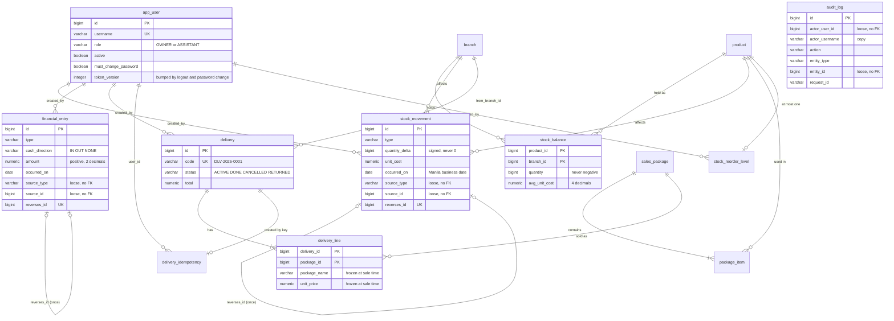

# Data model

PostgreSQL 17. Only Flyway migrations in [`src/main/resources/db/migration`](../../src/main/resources/db/migration) create or change the schema; Hibernate validates it against the entities (`ddl-auto: validate`).

## 1. Entity-relationship diagram

Two relationships are deliberately **not** foreign keys:

- `stock_movement` and `financial_entry` point at the record that caused them with `source_type` + `source_id`, so stock and finance never depend on the delivery tables ([decision 1](decisions.md#1-modular-monolith)).
- `audit_log` points at the changed record and the actor loosely and copies the username into the row, so the trail stays readable if a user or product is ever removed.

## 2. Tables

| Table | Module | Purpose | Mutable? |
|---|---|---|---|
| `app_user` | identity | accounts, roles, token version | password, role, active, token version |
| `audit_log` | audit | who changed users, products, branches, packages | **never** (triggers) |
| `branch`, `product` | catalog | the branches; what is bought and sold | name, unit, active |
| `sales_package`, `package_item` | catalog | a fixed bundle and its price; its contents | price, name, active; **contents never** |
| `stock_movement` | stock | append-only stock ledger | **never** |
| `stock_balance` | stock | read model: quantity and average cost per product and branch | only via the atomic statement in `StockBalanceRepository` |
| `stock_reorder_level` | stock | optional per-product low-stock level | latest value only (configuration) |
| `financial_entry` | finance | append-only money ledger | **never** |
| `delivery`, `delivery_line` | delivery | one sale and its packages, name and price frozen | status and its dates only; lines never |
| `delivery_idempotency` | delivery | which delivery a retry key produced | insert only |
| `delivery_code_seq` | delivery | sequence behind the readable code | n/a |

## 3. Rules the database enforces itself

Repeated from the Java code on purpose: a bug or a hand-run SQL statement still cannot break them.

| Rule | Constraint |
|---|---|
| Stock never negative | `stock_balance.quantity >= 0` |
| A movement changes something, in a legal direction, and says why for usage and adjustment | `quantity_delta <> 0`, `ck_movement_sign`, `ck_movement_reason` |
| A movement or entry is reversed at most once | `reverses_id unique` |
| Costs and amounts are valid | `unit_cost >= 0`, `avg_unit_cost >= 0`, `amount > 0` |
| Entry type fixes cash direction; cash entries have a method; only sale and cost entries reverse | `ck_entry_direction`, `ck_entry_method`, `ck_entry_reversal` |
| Status and dates agree | `ck_delivery_done`, `ck_delivery_cancelled` |
| A delivery has a positive total and positive lines | `total > 0`, `quantity > 0`, `unit_price > 0` |
| One delivery per (key, user) | primary key `(idempotency_key, user_id)` |
| The audit trail cannot be rewritten | row triggers refuse `UPDATE` and `DELETE`; a statement trigger refuses `TRUNCATE` |
| Reorder level never negative, one per product | `reorder_level >= 0`, primary key `product_id` |
| Names, SKUs, codes unique | `unique` on `branch`, `product`, `sales_package`, `delivery`, `app_user` |
| A package lists a product once, with positive quantity | primary key `(package_id, product_id)`, `quantity > 0` |

Proven against a real database by `StockLedgerTests.movementSignRulesAreEnforcedInJavaAndInTheDatabase` and `FinanceAndCostTests.theDatabaseRejectsEntriesWhoseDirectionContradictsTheirType`.

## 4. Migration rules

1. **Never edit a migration that has been applied anywhere.** Flyway stores a checksum; change the schema with a new migration.
2. Version numbers may have gaps, but always add one above the highest existing number (`outOfOrder` is off).
3. A migration that adds a `not null` column to a table with data supplies a default or backfills in the same migration.
4. Every constraint above is part of the design; dropping one needs a decision entry.
5. A table that must never be rewritten gets a trigger, not just a convention (`audit_log`).
