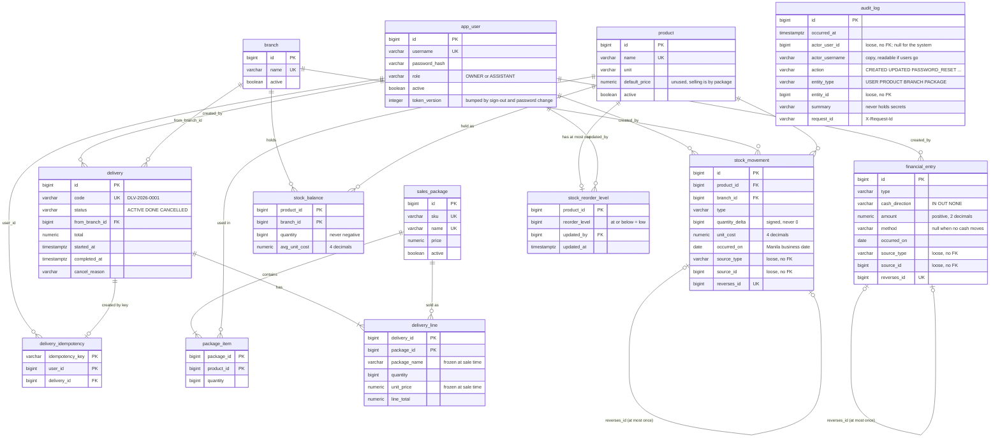

# Data model

PostgreSQL 17. The schema is created and changed only by Flyway migrations in
[`src/main/resources/db/migration`](../../src/main/resources/db/migration); Hibernate validates it against the entities
(`ddl-auto: validate`) and never alters it.

## 1. Entity-relationship diagram

Two kinds of relationship are deliberately **not** drawn, because they are not foreign keys:

- `stock_movement` and `financial_entry` point at the record that caused them with `source_type` + `source_id` (for example
  `DELIVERY`, 42 or `STOCK_MOVEMENT`, 17), so the stock and finance modules never depend on the delivery module's tables
  ([ADR-0001](decisions/0001-modular-monolith.md)).
- `audit_log` points at the changed record with `entity_type` + `entity_id` and at the person with `actor_user_id`, and copies
  the username into the row. The trail is therefore readable even if a user or product is ever removed, and `audit` does not
  depend on the tables of the modules it records.

## 2. Tables

| Table | Module | Purpose | Mutable? |
|---|---|---|---|
| `app_user` | identity | Accounts, roles and the token version | yes (password, role, active, token version) |
| `audit_log` | audit | Append-only trail of who changed users, products, branches and packages | **never** (refused by triggers) |
| `branch` | catalog | The two branches | name, active |
| `product` | catalog | Things the business buys and sells | name, unit, active |
| `sales_package` | catalog | A fixed bundle with a price | name, price, active; **contents never** |
| `package_item` | catalog | What a package contains | no (fixed at creation) |
| `stock_movement` | stock | Append-only stock ledger | **never** |
| `stock_reorder_level` | stock | Optional per-product level at or below which a branch counts as low | yes (latest value only; it is configuration, not a ledger) |
| `stock_balance` | stock | Current quantity and average cost per product and branch: a fast read model of the ledger | only through the atomic statement in `StockBalanceRepository` |
| `financial_entry` | finance | Append-only money ledger | **never** |
| `delivery` | delivery | One sale and its trip | status and its dates only |
| `delivery_line` | delivery | Packages sold, with the name and price frozen at that time | no |
| `delivery_idempotency` | delivery | Which delivery a client's retry key produced | insert only |
| `delivery_code_seq` | delivery | Sequence behind the human-readable code | n/a |

## 3. Rules the database enforces itself

These are repeated from the Java code on purpose: a bug or a hand-run SQL statement still cannot break them.

| Rule | Constraint | Table |
|---|---|---|
| Stock can never be negative | `check (quantity >= 0)` | `stock_balance` |
| A movement changes something, in a legal direction | `quantity_delta <> 0`; `ck_movement_sign` (in-types positive, out-types negative, adjustment either) | `stock_movement` |
| Usage and adjustments say why | `ck_movement_reason` | `stock_movement` |
| A movement is reversed at most once | `reverses_id unique` | `stock_movement` |
| Costs are never negative | `check (unit_cost >= 0)`, `check (avg_unit_cost >= 0)` | `stock_movement`, `stock_balance` |
| Amounts are positive | `check (amount > 0)` | `financial_entry` |
| The entry type fixes the cash direction | `ck_entry_direction` | `financial_entry` |
| Cash entries have a method, others do not | `ck_entry_method` | `financial_entry` |
| Only sale and cost entries can be reversals, and each is reversed at most once | `ck_entry_reversal`; `reverses_id unique` | `financial_entry` |
| Status and dates agree | `ck_delivery_done` (DONE iff completed), `ck_delivery_cancelled` (CANCELLED iff reason and time) | `delivery` |
| A delivery has a positive total and positive lines | `check (total > 0)`, `check (quantity > 0)`, `check (unit_price > 0)` | `delivery`, `delivery_line` |
| One delivery per (key, user) | primary key `(idempotency_key, user_id)` | `delivery_idempotency` |
| The audit trail cannot be rewritten | row triggers refuse `UPDATE` and `DELETE`; a statement trigger refuses `TRUNCATE` | `audit_log` |
| A reorder level is never negative; a product has at most one | `check (reorder_level >= 0)`; primary key `product_id` | `stock_reorder_level` |
| Names, SKUs and codes are unique | `unique` | `branch`, `product`, `sales_package`, `delivery`, `app_user` |
| A package lists a product once, with a positive quantity | primary key `(package_id, product_id)`; `check (quantity > 0)` | `package_item` |

Tests that prove them against a real database: `StockLedgerTests.movementSignRulesAreEnforcedInJavaAndInTheDatabase`,
`FinanceAndCostTests.theDatabaseRejectsEntriesWhoseDirectionContradictsTheirType`.

Names and units are still free text: see [../quality/findings.md](../quality/findings.md), Q-002, about names that differ only by
surrounding spaces.

## 4. Migrations

| Version | Content |
|---|---|
| V1 | `app_user` |
| V2 | `branch`, `product`, seed branches and products |
| V3 | `stock_balance`, `stock_movement` and their constraints |
| V4 | Average cost columns; `financial_entry` |
| V5 | `sales_package`, `package_item` (seed: the three official packages), `delivery`, `delivery_line`, `delivery_code_seq` |
| V7 | `delivery_idempotency` |
| V10 | `stock_reorder_level` (reorder levels for low-stock flags) |
| V20 | `app_user.token_version` (sign-out and password-change revocation); `audit_log` with its append-only triggers |

`V6`, `V8`, `V9` and `V11`-`V19` are absent from the repository (V10-V19 and V20-V29 were reserved for parallel work, and
not every number was used). Flyway accepts gaps in version numbers; it does not accept a *lower* number appearing after a
higher one was applied (`outOfOrder` is off), so always add a number above the highest existing one.

Rules (also in the README):

1. **Never edit a migration that has been applied anywhere.** Flyway stores a checksum; changing the file breaks every database
   that already ran it. Change the schema with a new migration.
2. A migration that adds a `not null` column to a table with data supplies a default or backfills it in the same migration.
3. Every constraint above is part of the design. Dropping one needs an ADR.
4. Parallel work that adds migrations agrees on number ranges beforehand to avoid two files with one version.
5. A table that must never be rewritten gets a trigger, not just a convention (`audit_log`, V20).
