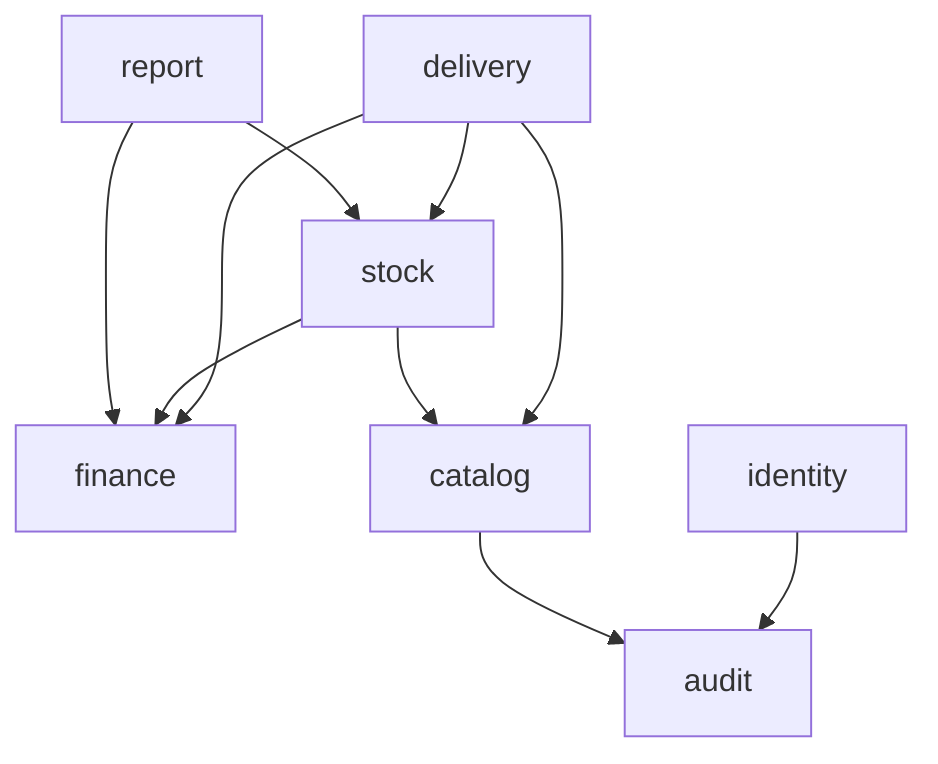
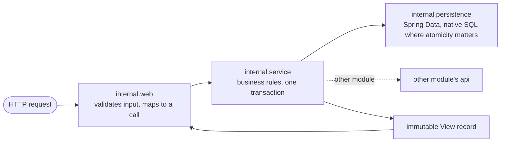

# Architecture overview

The **Ausan Poultry System** backend records stock, deliveries and money for a two-branch trading business and reports on them (business context: [product.md](../product.md)). Currency is PHP; the business zone is `Asia/Manila`.

## 1. System context


One process, one database, one deployable. The frontend talks to the backend only through the [HTTP API](../api/README.md).

## 2. Modules

A **modular monolith** ([decision 1](decisions.md#1-modular-monolith)): packages under `kyle.poultry`, each with a public `api` package and a private `internal` package ([decision 7](decisions.md#7-api-and-internal-packages)).

| Module | Responsibility | Public face |
|---|---|---|
| `shared` | error handling, clock and business date, `SourceRef`, CSV writing, request-id filter, OpenAPI contract | `RuleViolation`, `ConflictException`, `NotFoundException`, `SourceRef`, `Csv` |
| `audit` | append-only trail of changes to users, products, packages, branches | `AuditApi` |
| `identity` | users, roles, login, JWT, bootstrap owner, forced password change, immediate revocation, CORS | `Actor`, `Role`, `Capability`, `@RequiresCapability` |
| `catalog` | products, branches, sales packages | `CatalogApi` |
| `stock` | append-only movements, balances, weighted average cost, summary, reorder levels | `StockApi`, `InsufficientStockException` |
| `finance` | append-only ledger, refunds, period aggregates | `FinanceApi`, `EntryType`, `PaymentMethod` |
| `delivery` | deliveries and their lifecycle; orchestrates stock and finance | none (HTTP only) |
| `report` | read-only reports, dashboard, series | none (HTTP only) |

### Dependency direction



Every module may also use `shared`, and business modules use `identity` for `Actor`. Allowed dependencies, exactly as enforced:

| Module | May depend on |
|---|---|
| `shared` | nothing |
| `audit` | `shared` |
| `identity`, `catalog` | `audit`, `shared` |
| `finance` | `identity`, `shared` |
| `stock` | `catalog`, `finance`, `identity`, `shared` |
| `delivery` | `catalog`, `stock`, `finance`, `identity`, `shared` |
| `report` | `finance`, `stock`, `identity`, `shared` |

Rules, each failing the build when broken ([ModuleBoundaryTests](../../src/test/java/kyle/poultry/architecture/ModuleBoundaryTests.java), [CodingRulesTests](../../src/test/java/kyle/poultry/architecture/CodingRulesTests.java)):

1. Modules depend only on the modules above, with no cycles.
2. Code outside a module uses only its `api` package. Entities, repositories, controllers and service implementations stay in `internal`.
3. A module never reads another module's tables. Ledger rows point at the record that caused them with a loose `SourceRef(type, id)`, not a foreign key.
4. `audit` knows nothing about its callers. Callers say *what* happened; *who* is read from the security context inside `audit`, so it cannot be forged.
5. The direction is fixed: delivery -> stock -> finance / catalog. Finance never imports "delivery".

## 3. Inside a module

```
<module>/
├── api/        what other modules may use: <Module>Api, model/, exception/, security/
└── internal/   web/ (controllers), service/ (rules, transactions, *Api implementation),
                model/, persistence/ (entities, repositories), plus security, config, export where needed
```

`delivery` and `report` are called by no module, so they have no `api`. No class sits loose at a module root.



- **Controller:** `@Valid`, `@RequiresCapability`, JSON to call and back. No repositories, no transaction, no entities in signatures.
- **Service:** the module's rules and transaction boundary; implements the `*Api`.
- **Entity:** owns the invariants of one record (status transitions, movement sign rules) so they hold wherever it is used.
- **View:** an immutable record; persistence classes never leave the module.

## 4. Cross-cutting rules

| Topic | Rule |
|---|---|
| **Transactions** | A request is one transaction; every `*Api` call joins it, so a delivery, its stock movements and its ledger rows commit together or not at all. Reads are `readOnly`. ([sequences](sequences.md)) |
| **Time** | "Now" and "today" come from the injected `Clock` (`Asia/Manila`); production code never calls no-argument `now()` (`CodingRulesTests`). |
| **Money** | `BigDecimal`, PHP, scale 2, half-up; unit costs have 4 decimals. The entry *type*, never a sign, gives direction. ([ledger and concurrency](ledger-and-concurrency.md)) |
| **Errors** | RFC 9457 problem details: 404 not found, 422 rule violation, 409 conflict (including constraint clashes), 400 validation, 401, 403. ([errors](../api/errors.md)) |
| **Security** | Stateless JWT re-checked against the database on every request; throttled login; deny-by-default CORS. ([security](../security.md)) |
| **Audit** | Every master-data change writes one `audit_log` row in the same transaction; database triggers refuse update, delete and truncate. |
| **Tracing** | Every request gets an `X-Request-Id`, put in the log context and stored with audit rows. |
| **History** | Stock movements and ledger entries are never updated or deleted; a correction is a new row. |
| **Idempotency** | Delivery creation accepts an `Idempotency-Key`; a retry returns the original. |
| **Schema** | Flyway migrations, never edited once applied; Hibernate only validates. |

## 5. Runtime

Configuration comes from the environment, with no secrets in the repository. The JWT secret has no default and must be at least 32 bytes with 16 distinct byte values, or the app refuses to start. Flyway migrates on start-up and Hibernate validates (`ddl-auto: validate`). The first owner is created from `APP_BOOTSTRAP_OWNER_*` only when the user table is empty. Container topology, deployment and recovery: [README](../../README.md#docker-infrastructure), [operations](../operations.md).

## 6. Known limits

Single application instance (the login throttle is in memory). No token refresh. No transfers between branches. `product.default_price` is unused: selling is by package.
