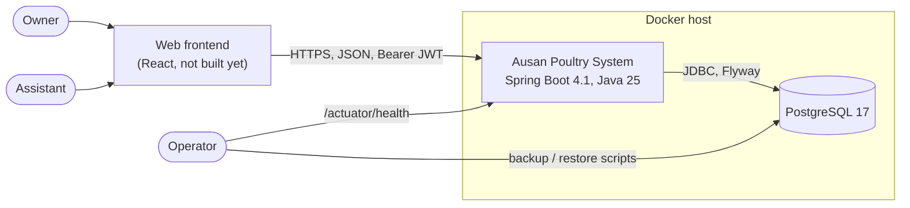
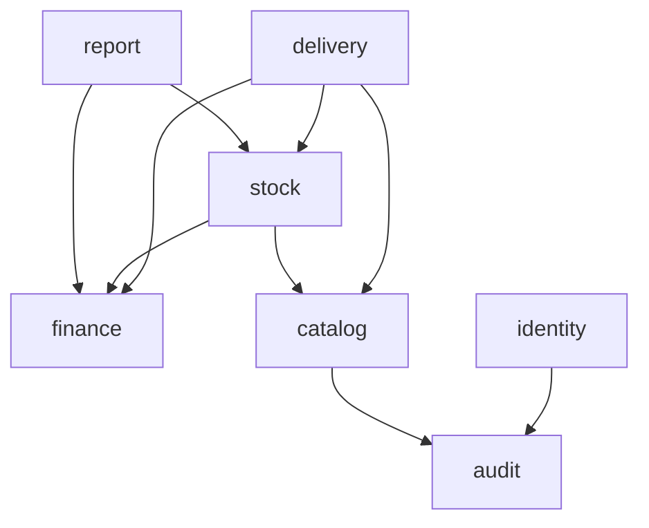
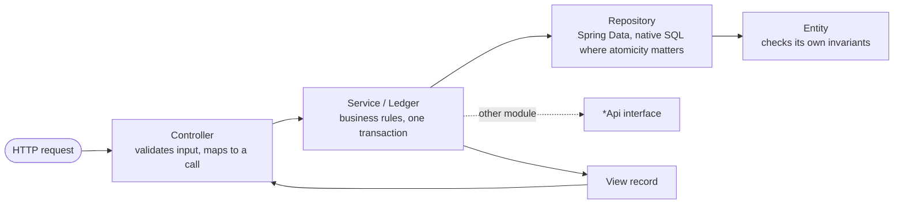
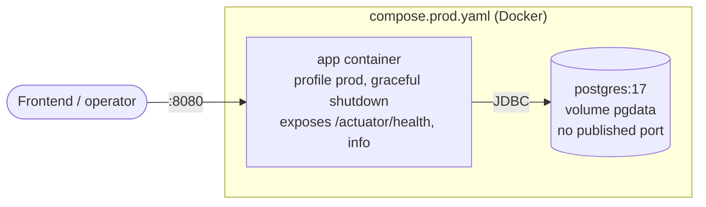

# Architecture overview

Ausan Poultry Farm is a **trading business** (it buys cages, chickens, nipples, feeders, feed and water jugs, and resells them in
fixed packages through deliveries) with two branches. The **Ausan Poultry System** (this backend) records the stock, the deliveries and the money, and
reports on them. Currency is PHP. The business context is in
[../business-and-system-proposal.md](../business-and-system-proposal.md); this document describes the software.

## 1. System context

One backend process, one database, one deployable. The frontend talks to the backend only through the documented HTTP API
([../api.md](../api.md)).

## 2. Modules

The code is a **modular monolith** ([ADR-0001](decisions/0001-modular-monolith.md)): one application, divided into packages under
`kyle.poultry`, each a module with a clear job and a public face.

| Module | Responsibility | Public face (other modules may use) |
|---|---|---|
| `shared` | Error handling, the shared exceptions, the clock, the loose `SourceRef` pointer, CSV writing, the request-id filter (`shared.web`) | `RuleViolation`, `ConflictException`, `NotFoundException`, `SourceRef`, `Csv`, `RequestIdFilter` |
| `audit` | Append-only trail of who changed users, products, packages and branches; the owner-only audit query | `AuditApi`, `AuditAction`, `AuditEntity`, `AuditChanges` |
| `identity` | Users, roles, login, sign-out, password change, JWT, bootstrap owner, immediate revocation, CORS | `Actor`, `Role` |
| `catalog` | Products, branches, sales packages (every change is recorded in the audit trail) | `CatalogApi` |
| `stock` | Append-only stock movements, balances, weighted average cost, the all-branch summary and reorder levels | `StockApi` |
| `finance` | Append-only financial ledger, refunds, period aggregates | `FinanceApi` |
| `delivery` | Deliveries and their lifecycle; orchestrates stock and finance | (none: only HTTP) |
| `report` | Read-only profit, cash and inventory-value reports | (none: only HTTP) |

### Dependency direction

Every module may also use `shared`, and the business modules use `identity` (for `Actor`); those arrows are left out to keep the
picture readable. The complete allowed set, which is exactly what the test enforces:

| Module | May depend on |
|---|---|
| `shared` | nothing |
| `audit` | `shared` |
| `identity` | `audit`, `shared` |
| `catalog` | `audit`, `shared` |
| `finance` | `identity`, `shared` |
| `stock` | `catalog`, `finance`, `identity`, `shared` |
| `delivery` | `catalog`, `stock`, `finance`, `identity`, `shared` |
| `report` | `finance`, `stock`, `identity`, `shared` |

Rules, and the tests that fail the build when they are broken:

1. A module depends only on the modules listed above, and the module graph has no cycles
   ([ModuleBoundaryTests](../../src/test/java/kyle/poultry/architecture/ModuleBoundaryTests.java)).
2. Code outside a module uses only its **public** types. Entities, repositories, controllers and service implementations are
   package-private, so the compiler already refuses most violations; the test catches the rest (same test class).
3. A module never reads another module's tables. Cross-module data goes through the `*Api` interface, and the
   ledgers refer to the business record that caused a row with a loose `SourceRef(type, id)` instead of a foreign key.
4. `audit` sits at the bottom with `shared`: it knows nothing about the modules that write to it. Callers pass only *what*
   happened; *who* did it is read from the security context inside `audit`, so a caller cannot forge it.
5. The direction is fixed: **delivery -> stock -> finance / catalog**. Finance knows nothing about stock or delivery; stock
   knows nothing about delivery. That is why a purchase can be recorded in stock (which calls finance for the cash) and a
   delivery can be cancelled without finance ever importing the word "delivery".

## 3. Inside a module

- **Controller**: bean validation (`@Valid`), role checks (`@PreAuthorize`), translation between JSON and a service call. No
  repository access, no transaction, no entities in its signatures.
- **Service / ledger**: the module's rules and its transaction boundary. A class that implements an `*Api` interface is the only
  public entrance and is itself package-private.
- **Entity**: owns the rules that belong to one record (a delivery's status transitions, a movement's sign rules) in static
  factories and methods, so the rule holds wherever the entity is used.
- **View**: an immutable record handed to callers; persistence classes never leave the module.

Enforced by [CodingRulesTests](../../src/test/java/kyle/poultry/architecture/CodingRulesTests.java): controllers do not touch
repositories or entities, are not transactional and are named `...Controller`; entities and repositories are not public; `*Api`
types are interfaces and their implementations are not public; no field injection; no `System.out`; no `java.util.logging`.

## 4. Cross-cutting rules

| Topic | Rule | Where it lives |
|---|---|---|
| **Transactions** | A request is one transaction. Every `*Api` method joins the caller's transaction, so a delivery, its stock movements and its ledger rows commit together or not at all. Reads are `readOnly`. | `@Transactional` on services; [sequences.md](sequences.md) |
| **Time** | "Now" and "today" always come from the injected `Clock`, whose zone is `Asia/Manila` (`app.zone`). No production code may call the no-argument `now()`. A business date is the Manila calendar date, never the server's. | `ClockConfig`; `CodingRulesTests.timeComesFromTheInjectedClock` |
| **Money** | `BigDecimal`, PHP. Amounts are positive with at most two decimals and stored at scale 2; the entry *type*, never a sign, gives the direction. Unit costs have four decimals. Rounding is half-up. | `FinanceLedger.normalise`, `StockMovement.create`; [ledger-and-costing.md](ledger-and-costing.md) |
| **Errors** | RFC 9457 `ProblemDetail`. Not found 404, rule violation 422, conflict 409 (including database constraint clashes), bean validation 400, wrong role 403, bad token 401. | `shared/ApiExceptionHandler`; [../api.md](../api.md) |
| **Security** | Stateless HS256 JWT; every endpoint except login and health needs a token; the user is re-read from the database on every request so a deactivation, role change, sign-out or password change applies at once (the token carries a version that must match); failed logins are throttled; CORS allows only the configured origins. | [ADR-0003](decisions/0003-stateless-jwt-with-database-recheck.md); `SecurityMatrixTests` |
| **Audit trail** | Every change to a user, product, branch or package writes one `audit_log` row **in the same transaction** (so a change never commits without its entry, nor an entry without its change). The table refuses update, delete and truncate through database triggers. | [data-model.md](data-model.md); `audit` module |
| **Request tracing** | Every request gets an `X-Request-Id` (a safe client value is kept, otherwise one is generated), put in the log context with the user id and echoed in the response, even on 401 and 403; the id is stored with each audit row. | `shared.web.RequestIdFilter`; [../security/observability.md](../security/observability.md) |
| **Append-only history** | Stock movements and financial entries are never updated or deleted; a correction is a new row. | [ADR-0002](decisions/0002-append-only-ledgers.md) |
| **Idempotency** | Delivery creation accepts an `Idempotency-Key`; a retry returns the original delivery. | [ADR-0005](decisions/0005-idempotent-delivery-creation.md) |
| **Schema evolution** | Flyway migrations, never edited once applied; Hibernate only validates the schema. | [data-model.md](data-model.md) |

## 5. Runtime view

- Configuration comes from the environment (`.env`); there are no secrets in the repository. The JWT signing secret has no default,
  so the application refuses to start without one.
- Flyway runs on start-up and brings the schema to the current version; Hibernate validates it (`ddl-auto: validate`).
- The first owner is created from `APP_BOOTSTRAP_OWNER_*` only when the user table is empty.
- Deployment, upgrade, rollback, backup and restore: [../operations.md](../operations.md).

## 6. Quality attributes and how they are achieved

| Attribute | Approach | Evidence |
|---|---|---|
| **Auditability** | Append-only ledgers; every row carries who and when; corrections are visible reversals | Database check constraints; `StockLedgerTests`, `FinanceAndCostTests` |
| **Consistency** | One transaction per request; atomic balance statement; row locks; unique constraints as the last line of defence | [consistency-and-concurrency.md](consistency-and-concurrency.md); `DeliveryConcurrencyTests` |
| **Correct money** | Independent oracle for the average cost; hand-calculated scenarios; ledger always sums to the balance | `WeightedAverageCostTests`, `FinanceLedgerUnitTests` |
| **Modularity** | Enforced boundaries, package-private internals | `ModuleBoundaryTests`, `CodingRulesTests` |
| **Testability** | Injected clock, explicit `Actor`, no static state, real PostgreSQL in tests | [../quality/README.md](../quality/README.md) |
| **Operability** | Health endpoint, graceful shutdown, backup/restore scripts and a documented restore drill | [../operations.md](../operations.md) |

## 7. Known limits (by design, for now)

- **One application instance.** The login throttle is in memory, per instance (lost on restart). Running several instances would
  need a shared store for it. The database design itself has no single-instance assumption.
- **No token refresh.** A token lives eight hours (sign-out ends it earlier); rotating the signing secret signs everybody out
  ([../operations.md](../operations.md) section 6).
- **No transfers between branches** and no raising of chickens: out of scope for this system.
- **Per-product `default_price` is unused**; selling is by package. The column remains for history.
