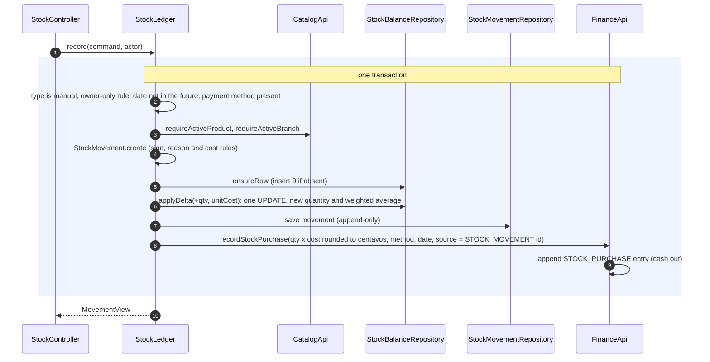
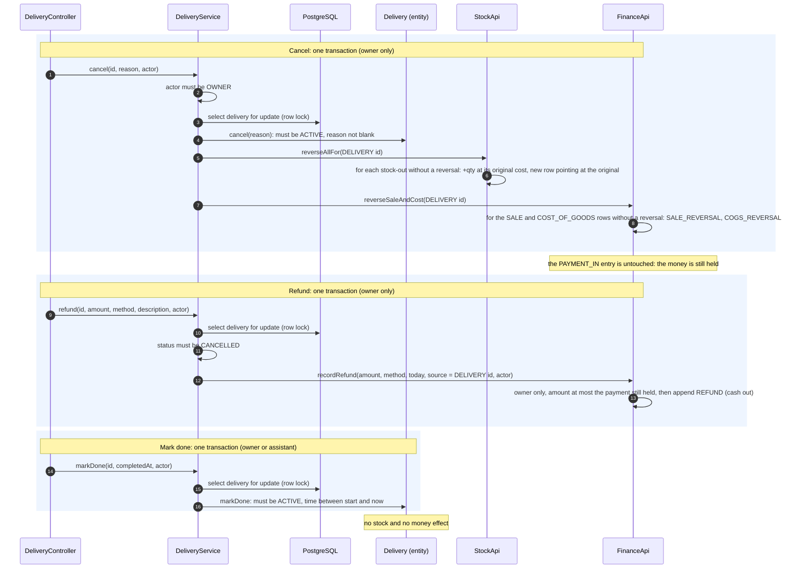

# Key flows

Sequence diagrams of the flows where several modules cooperate. The transaction boundary is shown as a box: everything inside
commits together or not at all. Names are the real classes and methods, so each step can be found in the code.

## 1. Sign in and authenticate a request

```mermaid
sequenceDiagram
    autonumber
    actor U as User
    participant RID as RequestIdFilter
    participant AC as AuthController
    participant LT as LoginThrottle
    participant AS as AuthService
    participant DB as PostgreSQL
    participant F as Resource-server filter
    participant RC as RevocationAuthenticationConverter
    participant C as Any controller

    U->>RID: POST /api/auth/login {username, password}
    RID->>RID: keep a safe X-Request-Id or generate one; put it in the log context
    RID->>AC: request
    AC->>LT: is this (username, address) blocked?
    LT-->>AC: no (fewer than 5 failures in 15 minutes)
    AC->>AS: authenticate
    AS->>DB: load user by username
    AS->>AS: BCrypt check, user must be active
    AS-->>AC: HS256 JWT (sub = user id, role, ver = token version, 8 h expiry)
    AC-->>U: 200 {token, role, ...}

    Note over U,C: every later request
    U->>F: GET /api/... with Authorization: Bearer token
    F->>F: verify signature (HS256 only) and expiry
    F->>RC: verified token
    RC->>DB: load user by id (every request)
    RC-->>F: reject if missing, inactive or the ver claim differs from the stored token_version (401); replace the role claim with the database role
    F->>C: authenticated request
    C->>C: @PreAuthorize (role), then Actor.from(jwt)
```

Why the database is read on every request: a deactivated user, a changed role, a sign-out or a password change takes effect
immediately instead of when the token expires ([ADR-0003](decisions/0003-stateless-jwt-with-database-recheck.md)). `POST /api/auth/logout`
and `POST /api/auth/password` raise the user's `token_version`, so every token issued before stops working at once, on every device;
`GET /api/auth/me` returns the caller's profile. The `X-Request-Id` is echoed on every response, including 401 and 403.

## 2. Record a stock purchase



If the finance call fails (for example an invalid amount), the stock change rolls back with it: stock never changes without its
payment record.

## 2b. Change master data and leave an audit entry

```mermaid
sequenceDiagram
    autonumber
    participant CC as CatalogController
    participant CS as CatalogService
    participant AU as AuditApi (AuditService)
    participant DB as PostgreSQL

    CC->>CS: updatePackage(id, command)
    rect rgb(238, 245, 255)
    Note over CS,DB: one transaction
    CS->>DB: update the package
    CS->>CS: AuditChanges: compare old and new values, build "price: 70000.00 -> 75000.00"
    opt something actually changed
        CS->>AU: record(UPDATED, PACKAGE, id, summary)
        AU->>AU: actor from the security context ('system' if none); request id from the log context
        AU->>DB: insert audit_log row (triggers refuse any later update or delete)
    end
    end
    CS-->>CC: view
```

The entry commits with the change or not at all, and the caller never says who did it. Users (create, update, password reset and
change, sign-out), products, branches and packages are audited; the owner reads the trail with `GET /api/audit`.

## 3. Create a delivery

```mermaid
sequenceDiagram
    autonumber
    participant DC as DeliveryController
    participant DS as DeliveryService
    participant DB as PostgreSQL
    participant CA as CatalogApi
    participant SA as StockApi
    participant FA as FinanceApi

    DC->>DS: create(request, actor, Idempotency-Key?)
    rect rgb(238, 245, 255)
    Note over DS,FA: one transaction
    opt an Idempotency-Key was sent
        DS->>DB: pg_advisory_xact_lock(hash of user:key)
        DS->>DB: select delivery by (key, user)
        alt key already used
            DS-->>DC: the original delivery (or 422 if the body differs); nothing else happens
        end
    end
    DS->>DS: validate names, payment method, lines, quantities, price, start time
    DS->>CA: requireActiveBranch, requireActivePackage per line
    DS->>DS: expand packages into products (merged, ascending product id)
    DS->>DB: next code from delivery_code_seq, insert delivery (ACTIVE) and lines
    DS->>SA: deduct(lines, branch, source = DELIVERY id, business date, actor)
    SA->>SA: per product in ascending id: one atomic balance UPDATE that refuses to go below zero
    SA-->>DS: movements, each stamped with the average cost at that moment
    DS->>FA: recordSale(total)
    DS->>FA: recordCostOfGoods(sum of the movements' cost)
    DS->>FA: recordPayment(total, method)
    opt an Idempotency-Key was sent
        DS->>DB: insert delivery_idempotency (key, user, delivery)
    end
    end
    DS-->>DC: 201 DeliveryView
```

Failure: if any product lacks stock, `deduct` throws `InsufficientStockException` (409). The exception leaves the transaction, so
the delivery row, every earlier movement and every ledger row disappear, and the key is not consumed. The delivery *code*
sequence value is used up (sequences are not rolled back), so codes are unique but not gapless.

A delivery is paid in full when created: the sale, the cost of goods and the payment are written in the same transaction.

## 4. Mark done, cancel, refund



State machine of a delivery (enforced by `Delivery` and mirrored by `ck_delivery_*` constraints):

```mermaid
stateDiagram-v2
    [*] --> ACTIVE: create (stock out, sale + cost + payment written)
    ACTIVE --> DONE: mark done (arrival recorded)
    ACTIVE --> CANCELLED: cancel (owner; stock back, sale and cost reversed)
    DONE --> [*]
    CANCELLED --> CANCELLED: refund (owner; money back, up to what is held)
    CANCELLED --> [*]
```



`DONE` and `CANCELLED` are final: a finished delivery can never be cancelled, and a cancelled one never reopens. A refund does
not change the status; it adds a `REFUND` entry until the payment held is zero.
