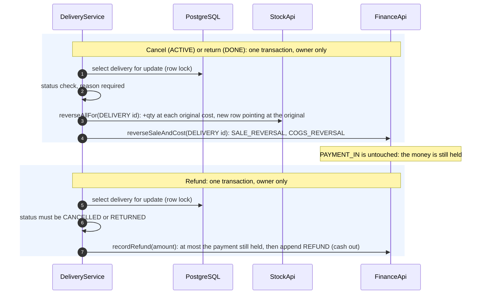

# Key flows

Where several modules cooperate. A box marks a transaction: everything inside commits together or not at all. Names are the real classes, so each step can be found in the code.

## 1. Sign in and authenticate a request

```mermaid
sequenceDiagram
    autonumber
    actor U as User
    participant AC as AuthController
    participant LT as LoginThrottle
    participant DB as PostgreSQL
    participant F as Resource-server filter
    participant RC as RevocationAuthenticationConverter
    participant C as Controller

    U->>AC: POST /api/auth/login {username, password}
    AC->>LT: blocked? (5 failures in 15 min per username + address)
    AC->>DB: load user; BCrypt check; must be active
    AC-->>U: 200 {token}: HS256 JWT (sub, ver = token version, 8 h)

    Note over U,C: every later request
    U->>F: Authorization: Bearer token
    F->>F: verify signature (HS256 only) and expiry
    F->>RC: verified token
    RC->>DB: load user by id
    RC-->>F: 401 if missing, inactive or ver differs from token_version; role comes from the database
    F->>C: request (a user who must change their password may only read profile, log out or change it)
    C->>C: @RequiresCapability, then Actor.from(jwt)
```

Reading the user on every request is what makes deactivation, role changes, logout and password changes immediate ([decision 3](decisions.md#3-stateless-jwt-with-a-database-re-check)). `X-Request-Id` is on every response, including `401` and `403`.

## 2. Create a delivery

```mermaid
sequenceDiagram
    autonumber
    participant DC as DeliveryController
    participant DS as DeliveryService
    participant DB as PostgreSQL
    participant CA as CatalogApi
    participant SA as StockApi
    participant FA as FinanceApi

    DC->>DS: create(request, actor, Idempotency-Key?)
    rect rgb(238, 245, 255)
    Note over DS,FA: one transaction
    opt key sent
        DS->>DB: pg_advisory_xact_lock(hash of user:key); find delivery by (key, user)
        DS-->>DC: if found: the original (422 if the body differs); nothing else happens
    end
    DS->>DS: validate input
    DS->>CA: requireActiveBranch, requireActivePackage per line
    DS->>DS: expand packages into products, merged, ascending product id
    DS->>DB: next code from delivery_code_seq; insert delivery (ACTIVE) and lines
    DS->>SA: deduct(lines, branch, source = DELIVERY id)
    SA->>SA: per product: one atomic UPDATE that refuses to go below zero
    SA-->>DS: movements stamped with the average cost at that moment
    DS->>FA: recordSale(total), recordCostOfGoods(sum), recordPayment(total, method)
    opt key sent
        DS->>DB: insert delivery_idempotency
    end
    end
    DS-->>DC: 201 DeliveryView
```

If any product lacks stock, `deduct` throws `InsufficientStockException` (`409`). The exception leaves the transaction, so the delivery row, every movement and every ledger row disappear and the key is not consumed. The code sequence value is used up, so codes are unique but not gapless.

## 3. Cancel, return, refund

```mermaid
stateDiagram-v2
    [*] --> ACTIVE: create (stock out; sale, cost, payment written)
    ACTIVE --> DONE: mark done (no stock or money effect)
    ACTIVE --> CANCELLED: cancel (owner)
    DONE --> RETURNED: return (owner; whole delivery)
    CANCELLED --> [*]
    RETURNED --> [*]
```





`CANCELLED` and `RETURNED` are final; a Done delivery can never be cancelled. A refund changes no status: it appends a `REFUND` until the payment held is zero.
