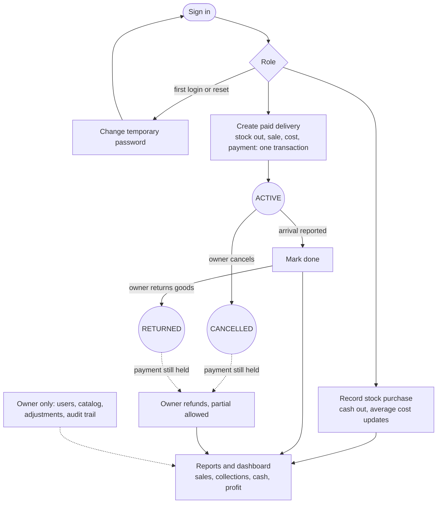

# Product: what it does and for whom

**Ausan Poultry Farm** is a trading business with two branches. It buys cages, chickens, nipples, water jugs, feeders and feed from suppliers and resells them in fixed packages through deliveries. Stock, deliveries and money used to live in notebooks, calculators and phone calls, so nobody could easily verify current stock, trace a delivery, or see how sales and expenses affected cash.

The **Ausan Poultry System** is the shared record: one place for stock, deliveries and finance, with a history that cannot be quietly rewritten. Currency is PHP; dates are Manila business dates.

## Users

| Role | Does | Cannot |
|---|---|---|
| **Owner** | everything: catalog and prices, users, opening stock and adjustments, cancellations, returns, refunds, cost and profit reports, audit trail | n/a |
| **Assistant** | records purchases, donations, usage, expenses and deliveries; marks deliveries done; reads stock, sales and collections | see cost or profit; enter opening stock or adjustments; cancel, return or refund; edit the catalog or users |

## User flow

## Core features

- **Stock per branch** from an append-only movement history: opening, purchase, donation, usage, adjustment. Every balance is explainable, never negative, and valued at weighted average cost. Low-stock flags come from per-product reorder levels.
- **Paid deliveries.** Creating one deducts its packages' contents from the branch and writes the sale, cost of goods and payment in one transaction; if stock is short, nothing is saved. Retries with an `Idempotency-Key` never double-sell.
- **Cancel, return, refund.** Cancelling an active delivery or returning a done one restores stock and reverses the sale, but keeps the customer's payment visible as *retained* until refunded.
- **Finance ledger.** Sales, payments, refunds, purchases and expenses as append-only entries.
- **Reports.** Net sales, collections, cash movement and profit as distinct figures for any period, plus a dashboard, day and month series and CSV exports. A stock purchase is cash out but reaches profit only when the stock is delivered, so cost is never counted twice.
- **Audit trail.** Who changed users, products, branches and packages, and what.
- **Two roles** with cost and profit hidden from assistants.

Out of scope: GPS and routing, a driver app, payroll, transfers between branches, multiple currencies. The web frontend (React) is not built yet.

## Glossary

| Term | Meaning |
|---|---|
| **Package** | A fixed bundle with a price (Small, Medium, Commercial) that customers buy. Contents never change once created. |
| **Movement** | One row of the stock ledger: a signed quantity of one product at one branch, for a reason (its type). |
| **Entry** | One row of the financial ledger. |
| **Ledger** | An append-only list of facts. Mistakes are fixed with new rows, never edits. |
| **Reversal** | A new row that exactly cancels an earlier one. The original is never changed. |
| **Adjustment** | A correction after a physical count (owner only, reason required) at the current average cost. |
| **Average cost** | Weighted average cost per unit of a product at a branch, four decimals. |
| **Cost of goods** | The cost of the stock a delivery took out, at the average cost of that moment. |
| **Retained payment** | Money still held for a cancelled or returned delivery: payments received minus refunds paid. |
| **Reorder level** | The quantity at or below which a branch counts as *low* on a product. |
| **Business date** | The Manila calendar date a movement or entry belongs to; reports use it. |
| **Delivery code** | Readable id such as `DLV-2026-0001`: unique, not gapless. |
| **Idempotency key** | A client-chosen value so a retried delivery request returns the original instead of creating another. |
| **Actor** | Who is acting: a user id and role, passed explicitly into every service call. |
| **`*Api`** | A module's public interface; the only way one module may use another. |
| **Request id** | The `X-Request-Id` shown in logs, responses and audit rows to follow one action everywhere. |
