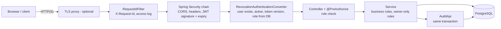

# Security: model, controls and operating notes

This is the security reference for the Ausan Poultry System backend: what is protected, who the adversaries are, which controls exist
(and the test that proves each), and what is knowingly **not** covered. It describes the system as built; keep it in the
same change as the code (see the table at the end).

Related: [observability.md](observability.md) (logs, request ids, metrics), [../operations.md](../operations.md)
(deploy, backups, secret rotation), [../api/auth-session.md](../api/auth-session.md) and [../api/audit.md](../api/audit.md)
(the contracts).

## 1. Scope and assets

A small trading business (two roles, two branches) running one application instance and one PostgreSQL database, reached
over HTTP(S) by a browser frontend or scripts.

| Asset | Why it matters | Where it lives |
|---|---|---|
| Financial ledger, stock ledger, deliveries | Money and inventory truth; must be accurate and tamper-evident | PostgreSQL, append-only by design |
| Credentials (BCrypt hashes) and the JWT signing secret | Whoever has the secret can mint tokens for anyone | `app_user.password_hash`; `APP_SECURITY_JWT_SECRET` |
| Customer names and destinations | Personal data | `delivery` rows |
| Audit trail | Evidence of who changed prices, users and catalog | `audit_log`, append-only |
| Availability | Deliveries are recorded in the field | the application and database |

## 2. Actors

| Actor | Trust | Can |
|---|---|---|
| Anonymous internet client | none | reach `POST /api/auth/login` and `/actuator/health` only |
| ASSISTANT | low-privilege staff | record purchases, usage, expenses, deliveries (create, done); read catalog, stock, ledger, reports (not profit) |
| OWNER | full | everything, including users, prices, cancellations, refunds, profit and the audit trail |
| Operator (whoever runs the host) | full, outside the app | owns the database, `.env` and backups; not defended against here |
| Malicious website visited by a logged-in user | none | can make the user's browser send requests; see CORS and CSRF below |

## 3. Trust boundaries and where decisions are made

Identity becomes trusted at the converter (signature, expiry, **then** a database read on every request). Permission is
enforced twice: the URL-level rule in `SecurityConfig` (authenticated; `/actuator/**` owner-only) and the method-level
`@PreAuthorize` on each controller. Some rules live in services because they depend on the data (for example OPENING and
ADJUSTMENT stock movements are owner-only).

The role in a token is **never trusted**: the converter overwrites it with the database value on every request, so a role
change, demotion or deactivation applies at once.

## 4. Threats and mitigations (STRIDE)

| # | Threat | Mitigation | Evidence (test) | Residual risk |
|---|---|---|---|---|
| S1 | Guessing or brute-forcing passwords | BCrypt; 5 failures per username+address in 15 minutes then `429`; unknown users cost the same BCrypt work (no user enumeration by timing); one message for every login failure | `LoginThrottleTests`, `UserAdministrationTests` | Throttle is in memory, per instance, reset on restart; an attacker rotating addresses and usernames is not slowed globally |
| S2 | Weak passwords | `PasswordPolicy`: 10+ characters, 72-byte cap, blocklist, not the username, not repeated | `PasswordPolicyTests`, `AuthSessionTests` | Blocklist is small, not a breach database; no MFA |
| S3 | Stolen or leaked token used after the user is done | 8-hour lifetime; **logout** and **password change/reset** invalidate all of a user's tokens at once (`token_version`); deactivation is checked on every request | `AuthSessionTests` | No per-device logout; a stolen token works until the user logs out or changes password |
| S4 | Forged token | HS256 pinned (no algorithm confusion); secret must be at least 32 bytes or startup fails; signature and expiry checked by the resource-server filter | `ApiSecurityTests` | One shared secret: whoever reads it can mint tokens. Rotate on suspicion (see operations guide) |
| S5 | Token with stale or missing version | Missing `ver` claim counts as version 0 (so tokens from before the feature work); any other mismatch is `401` | `AuthSessionTests.tokenVersionClaim...` | none |
| T1 | Editing history (ledger, stock, audit) | Ledgers are append-only by design; corrections are reversals; `audit_log` rejects UPDATE, DELETE and TRUNCATE in the database | `AuditTrailTests.theTableIsAppendOnlyInTheDatabase`, finance and stock tests | A DBA with superuser rights can drop the trigger; out of scope |
| T2 | Double submit creating two deliveries | `Idempotency-Key` header | `DeliveryIdempotencyTests` | Clients must send the header |
| R1 | "I did not change that price" | Audit trail: actor (id and username copy), action, changed fields, request id, in the same transaction as the change | `AuditTrailTests` | Stock and finance rows carry their own author; reads are not audited |
| I1 | Data exposed to the wrong role | Method-level role checks; assistant gets `403` for owner-only; everything that shows cost or profit is owner-only (profit report and series, delivery receipt, `profit*.csv`; the dashboard blanks its profit fields for assistants); audit owner-only; reorder-level changes owner-only; actuator owner-only | `SecurityMatrixTests` (every endpoint x anonymous/assistant/owner) | Roles are coarse: an assistant can read all branches' stock and all deliveries |
| I2 | Information in error responses | ProblemDetail with fixed messages for database errors; `prod` hides messages, stack traces and binding errors; login failures identical | `ApiSecurityTests`, prod profile | none known |
| I3 | Secrets or personal data in logs | Access log records method, path and status only (no query string, no body); audit summaries never include passwords or tokens; BCrypt hash never returned | `AuditTrailTests.userChanges...`, `UserAdministrationTests` | Customer names are in the database and API, by design |
| I4 | Browser-based cross-site calls | Bearer tokens only (no cookies), so a malicious site cannot ride an existing session; CORS restricts which origins browsers let read responses; wildcard origins refused at startup | `SecurityHeadersAndCorsTests`, `CorsPropertiesTests` | If the frontend ever stores the token in a cookie, CSRF protection must be added first |
| I5 | Clickjacking, MIME sniffing, referrer leaks | Response headers: CSP `default-src 'none'; frame-ancestors 'none'`, `X-Frame-Options: DENY`, `X-Content-Type-Options: nosniff`, `Referrer-Policy: no-referrer`, `Cache-Control: no-store`, `Permissions-Policy`, HSTS (HTTPS only) | `SecurityHeadersAndCorsTests` | The frontend's own pages need their own headers from whatever serves them |
| D1 | Overload | Request body limits and pagination caps (`size` max 100 on the audit trail); graceful shutdown; connection pool limits | partial | **No global rate limit** and no request-size limit beyond the server default; put a reverse proxy in front for public exposure |
| E1 | Assistant performing owner actions | `@PreAuthorize("hasRole('OWNER')")` on every owner-only endpoint; service-level rules for data-dependent permissions; the matrix test fails if an endpoint is added without a declared access level | `SecurityMatrixTests` | Method security runs after body validation, so an assistant sending an invalid body to an owner-only endpoint sees `400` instead of `403` (no data leaks) |
| E2 | Removing the last owner | Services refuse to deactivate or demote the last active owner, and an owner cannot deactivate themselves | `UserAdministrationTests` | none |
| E3 | Exposed operational endpoints | `/actuator/**` needs the OWNER role except `/actuator/health`; production exposes only `health` and `info` | `SecurityHeadersAndCorsTests` | none |

## 5. Controls by layer

### Authentication
- Login: `POST /api/auth/login`, BCrypt, throttled, constant-ish time for unknown users.
- Token: JWT HS256, claims `sub` (user id), `username`, `role` (informational), `ver` (token version), `iat`, `exp`.
- Per request: signature and expiry, then a primary-key read of the user: must exist, be active, and match the token
  version; the role comes from this row.
- Sign-out: `POST /api/auth/logout` raises `app_user.token_version`, which invalidates every older token of that user.

### Authorisation
Two roles. Owner-only endpoints are listed in [../api/](../api/) and enforced by `@PreAuthorize`; the full table of
endpoint x role is executable in `SecurityMatrixTests`, which also fails the build if a new endpoint has no row.

### Browser access
- CSRF protection is off **because** there are no cookies or sessions (stateless bearer tokens).
- CORS is deny-by-default: configure `APP_CORS_ALLOWED_ORIGINS`.

| Environment | `APP_CORS_ALLOWED_ORIGINS` | Behaviour |
|---|---|---|
| Development | unset: `http://localhost:5173,http://localhost:3000` | local Vite / dev servers may call the API |
| Production, frontend on another origin | `https://app.example.ph` (exact origin) | only that site may call the API from a browser |
| Production, frontend on the same origin | empty | no cross-origin access |

### Transport security
The application speaks plain HTTP inside the compose network. **Terminate TLS in front of it** (reverse proxy or load
balancer) for anything beyond a trusted LAN. HSTS is emitted only on requests the app sees as HTTPS, so the proxy must
send `X-Forwarded-Proto: https` and the application should run with `server.forward-headers-strategy=framework`
(set `SERVER_FORWARD_HEADERS_STRATEGY=framework` in the container environment) once a trusted proxy is in place. Do not
enable that setting when the app is directly reachable from the internet, because clients could then forge those headers.

### Data protection
- Passwords: BCrypt hashes only, never returned, logged or audited.
- Database port is not published in the production compose file.
- Backups contain everything above; protect and encrypt them (see operations guide).

### Audit and accountability
`audit_log` (users, products, branches, packages) plus `created_by` on stock movements, financial entries and
deliveries. See [../api/audit.md](../api/audit.md).

### Detection
Metrics for login outcomes (`ausan.auth.logins{outcome}`), logouts and audit entries, an access log per request, and
request ids end to end. Suggested alerts are in [observability.md](observability.md).

## 6. Known gaps (decide before wider exposure)

1. **No multi-factor authentication** and no account lockout beyond the per-address throttle.
2. **No global rate limiting.** Protect with a reverse proxy if the API is reachable from the internet.
3. **Login throttle is per instance and in memory.** Fine for one instance; use a shared store if the app is ever scaled out.
4. **Single shared signing secret** and no key rotation without logging everyone out (that is the documented rotation procedure).
5. **No refresh tokens**: a session lasts at most 8 hours, then the user logs in again.
6. **Coarse roles**: no per-branch restrictions.
7. **Read access is not audited** (only changes are).
8. Ledger rows are only as trustworthy as database access; there is no cryptographic chaining.

## 7. Keeping this document true

| If you change... | Update... |
|---|---|
| a role rule or add an endpoint | `SecurityMatrixTests.MATRIX` (the build fails otherwise), this page's section 4 if a threat row changes |
| token contents or lifetime | sections 4 (S3-S5) and 5, `docs/api/auth-session.md` |
| headers or CORS | section 4 (I4, I5), `SecurityHeadersAndCorsTests` |
| the audit scope | `docs/api/audit.md`, `AuditTrailTests` |
